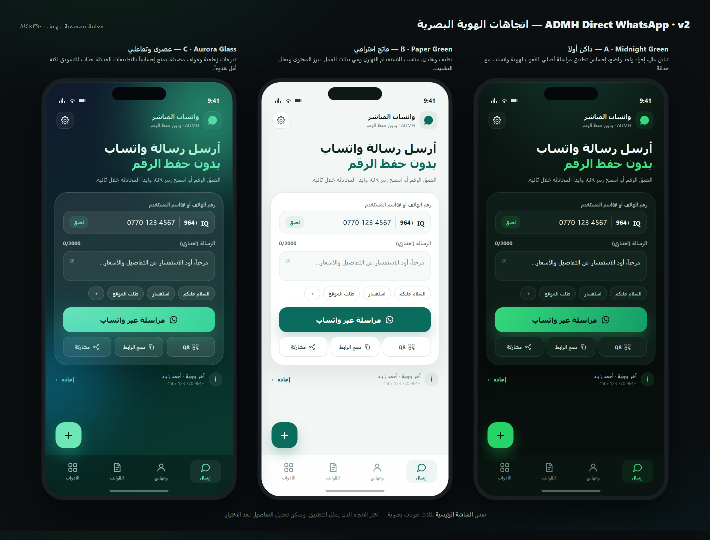

# مواصفات إعادة بناء ADMH Direct WhatsApp — الإصدار 2.0

> **الحالة:** ✅ **منفّذ** — اكتمل بناء v2 وفق القرارات الموضّحة في هذه الوثيقة (Aurora Glass + خط Cairo، كل الميزات F01–F35، React + Vite + TS، هوية تثبيت جديدة، عربي + إنجليزي). راجع [readme.md](readme.md) للتشغيل والنشر، و[§15](#15-حالة-التنفيذ-الفعلية) لما تم تسليمه فعلياً.
> **تاريخ الإعداد:** 4 نوفمبر 2026 · **النسخة الحالية المؤرشفة:** `v1.0-legacy` (وسم Git).
> **هدف هذه الوثيقة:** توثيق الرؤية والقرارات والمواصفات التي بُني عليها الإصدار 2.0.

---

## 0. كيف تقرأ هذه الوثيقة

| إن كنت تريد… | اذهب إلى |
|---|---|
| معرفة ما سأبنيه باختصار | [1. الملخص التنفيذي](#1-الملخص-التنفيذي) |
| معرفة عيوب النسخة الحالية | [2. التشخيص](#2-تشخيص-النسخة-الحالية-ما-نريد-إصلاحه) |
| فهم تصميم الهاتف | [4. مبادئ UX](#4-مبادئ-تصميم-الهاتف-15-مبدأ) و[5. الشاشات](#5-خريطة-الشاشات-والتدفقات) |
| رؤية الشكل | [6. الهوية البصرية](#6-الهوية-البصرية) (صورة الاتجاهات الثلاثة) |
| **اختيار الميزات** | **[8. قائمة الميزات](#8-قائمة-الميزات--اختر-من-هنا)** |
| معرفة القرارات المطلوبة منك | [13. القرارات المطلوبة](#13-القرارات-المطلوبة-منك) |

**لا حذف الآن.** لن أمسح أي ملف حتى تعتمد هذه الوثيقة (أو تعدّلها)، ثم أبدأ وفق خطة آمنة موضّحة في [§10](#10-خطة-التنفيذ-من-الصفر).

---

## 1. الملخص التنفيذي

**التطبيق اليوم:** أداة ويب عربية RTL تعمل كـPWA، تفتح محادثة واتساب مباشرة دون حفظ الرقم. كل شيء محلي: لا خادم، لا حساب، لا قاعدة بيانات، ولا إرسال تلقائي. الميزات الحالية: إدخال رقم/اسم مستخدم، رسالة اختيارية، نسخ الرابط، توليد QR وتنزيله، قراءة QR بالكاميرا أو الصورة، بطاقة مشاركة، مفضلة، قوالب، سجل، مظهر داكن/فاتح، وتحديث PWA.

**ما سنبنيه (v2):** تطبيق PWA مُعاد بناؤه من الصفر، **مصمّم للهاتف أولاً**، بواجهة حديثة (شريط سفلي، أوراق سفلية، حركات، اهتزاز، حالات فارغة)، ببنية كود منظمة قابلة للاختبار والتوسّع، مع الحفاظ على جوهر المنتج: **سريع، خاص، بلا خادم، بلا إرسال تلقائي**.

**ما لن يتغيّر:**
- الفكرة الأساسية: فتح محادثة واتساب مباشرة بدون حفظ الرقم.
- الخصوصية: لا يُرسل رقم أو رسالة إلى أي خادم، ولا تحليلات، ولا حسابات.
- الثبات: نشر ثابت (Static) على GitHub Pages، يعمل دون اتصال بعد أول تحميل.
- هوية التثبيت: الحفاظ على `id` و`start_url` الحاليين حتى لا تتحوّل التحديثات إلى تطبيق مختلف على أجهزة من ثبّتوه.

**ما سيتغيّر:** التصميم بالكامل (mobile-first حقيقي)، بنية الكود (React + TypeScript + Vite بدل ملف HTML واحد)، التخزين (IndexedDB بدل `localStorage` المتناثر)، إدارة PWA (Workbox)، الاختبارات (Vitest + Playwright + Lighthouse CI)، وتجربة الاستخدام (بدون `prompt()`/`confirm()`، مع شريط سفلي وأوراق سفلية).

**الالتزام الأخلاقي/العملي:** التطبيق **لا يرسل رسائل تلقائياً** ولا يبثّ رسائل جماعية دون تدخّل المستخدم. أي ميزة «حملة» ستكون مجرد تسهيل لفتح المحادثات واحدة تلو الأخرى مع تتبّع يدوي.

---

## 2. تشخيص النسخة الحالية (ما نريد إصلاحه)

قرأتُ الكود الحالي بالكامل: `index.html` (31KB، CSS وJS مضمّنان)، `enhancements.js`، `pwa-update.js`، `sw.js`، `vendor/qrcode.min.js`، وملفات PWA.

| # | المشكلة | الأثر على المستخدم | الحل في v2 |
|---|---|---|---|
| 1 | منطق تحليل الرقم مكرر في `index.html` و`enhancements.js` بقواعد مختلفة | نتائج متضاربة أحياناً بين «مراسلة» و«حفظ بالمفضلة» | طبقة `domain/phone.ts` واحدة مع اختبارات وحدة |
| 2 | المفضلة والمسح والبطاقة مدفونة في لوحة «أدوات إضافية» أسفل الصفحة خارج التدفق | ميزات قوية لا يكتشفها المستخدم | شريط تنقّل سفلي + شاشات واضحة (IA جديدة) |
| 3 | استخدام `prompt()` و`confirm()` لتسمية المفضلة وإضافة القوالب | نوافذ نظام قبيحة، غير متوافقة مع الهاتف، وتُفقد الكتابة بسهولة | أوراق سفلية ونماذج داخل التطبيق |
| 4 | قراءة QR تعتمد `BarcodeDetector` فقط (غير مدعوم في iOS Safari) | الميزة معطّلة على الآيفون وبعض المتصفحات | مسار احتياطي بـ`jsQR` (كاميرا + صورة) |
| 5 | بطاقة المشاركة تُولّد SVG بخط `Arial` | تشكيل العربية قد يظهر مشوّهاً على بعض الأجهزة | رسم عبر Canvas بخط عربي مضمّن + تصدير PNG |
| 6 | البيانات في `localStorage` متفرقة بلا نسخة احتياطية | فقدان كل شيء عند مسح بيانات الموقع أو نفاد المساحة | IndexedDB + تصدير/استيراد JSON + ترحيل بيانات v1 |
| 7 | لا `share_target` ولا اختصارات PWA | تفوت أفضل نقاط الدخول على الهاتف (مشاركة رقم من تطبيق آخر، ضغط مطوّل على الأيقونة) | إضافة `share_target` و`shortcuts` |
| 8 | لا طبقة ترجمة ولا إعدادات لغة | صعوبة التوسّع لجمهور غير عربي | `i18n` خفيفة (عربي افتراضياً) |
| 9 | لا اختبارات ولا فحص Lighthouse آلي | مخاطر انحدار صامتة مع كل تحديث | Vitest + Playwright + CI على GitHub Actions |
| 10 | التصميم الحالي عمودي بعرض 620px مركزي (أقرب لسطح المكتب) | لا يستفيد من مساحة الهاتف وأسفل الشاشة (منطقة الإبهام) | إعادة تصميم mobile-first كاملة |

**نقاط قوة يجب الحفاظ عليها:** التحقق التنسيقي الجيد للأرقام، دعم الأسماء المستخدمة والروابط، خصوصية كاملة، تجربة تحديث PWA بموافقة المستخدم، توثيق هوية التثبيت، ودعم RTL.

---

## 3. الرؤية والجمهور

### 3.1 جملة المنتج
> «أسرع طريقة لبدء محادثة واتساب من هاتفك — بدون حفظ رقم، وبدون أن يغادر رقمك جهازك.»

### 3.2 الجمهور المستهدف
| الشريحة | الحاجة الأساسية |
|---|---|
| صاحب متجر / مطعم / خدمة | رابط وQR وملصق يفتح محادثة الطلب، وقوالب ردود جاهزة |
| مندوب / مستقل | فتح محادثة عميل بسرعة أثناء التنقل، دون تخزين الرقم |
| مسوّق / صفحة أعمال | روابط وقوالب ورسائل متغيّرة، ومشاركة سهلة |
| مستخدم عادي | مراسلة رقم مؤقت (توصيل، إعلان، استفسار) دون حفظه |
| عراقي/عربي مغترب | التعامل مع أرقام محلية ودولية بصيغ مختلفة |

### 3.3 قصص استخدام (سيناريوهات)

1. **صاحب متجر:** يفتح التطبيق، يمسح QR على ملصق طاولة، يرسل «تم استلام طلبك». لا رقم محفوظ ولا تطبيق إضافي.
2. **مندوب توصيل:** يستقبل رقم العميل في واتساب، ينسخه، يلصقه في التطبيق، يضيف رسالة «أنا عند البوابة»، يفتح المحادثة بنقرة.
3. **مستخدم عادي:** يرى إعلاناً فيه رقم، يستخدم «استخراج رقم من النص»، يفتح المحادثة بدون حفظ الرقم.
4. **مسوّق:** يشارك بطاقة QR من ملف تعريفه، أو يصدّر ملصقات A4 لطاولات المقهى.
5. **مستخدم حذر:** يفعّل قفل التطبيق ببصمة/PIN، ويخفي الأرقام في الأماكن العامة.

### 3.4 لماذا PWA وما لا نفعله
- **لماذا:** تثبيت فوري بلا متجر، تحديث تلقائي، حجم صغير، يعمل أوفلاين، تجربة قريبة من الأصلية، ونشر على GitHub Pages بلا تكلفة.
- **ما لا نفعله:** لا إرسال تلقائي أو بث غير مرغوب، لا قراءة حالة «تم القراءة»، لا سحب لجهات الاتصال دون إذن، لا خادم وسيط، لا تحليلات تتبع، لا بيع بيانات.

---

## 4. مبادئ تصميم الهاتف (15 مبدأ)

1. **الإبهام أولاً:** التنقّل في شريط سفلي من 4 تبويبات؛ الإجراء الأساسي (مراسلة) في متناول الإبهام لا أعلى الشاشة.
2. **شاشة واحدة = مهمة واحدة:** الشاشة الرئيسية تقوم بشيء واحد: بدء محادثة، بثلاث خطوات كحد أقصى.
3. **أوراق سفلية بدل النوافذ:** كل خيار/تسمية/تأكيد يظهر كـBottom Sheet قابلة للسحب والإغلاق، لا `prompt()`.
4. **أهداف لمس ≥ 44 بكسل** ومسافات 8px، مع تمييز واضح لحالة الضغط.
5. **احترام الحواف الآمنة:** `viewport-fit=cover` و`env(safe-area-inset-*)`، وشريط حالة بلون الصفحة.
6. **دعم لوحة المفاتيح:** إخفاء الشريط السفلي عند الكتابة، وتمرير الحقل إلى منطقة مرئية، و`enterkeyhint` مناسب.
7. **RTL منطقي:** استخدام `margin-inline`/`inset-inline`، والحقول الرقمية `dir="ltr"` داخل سياق عربي، وأرقام بخط جدولي.
8. **PWA أصلية الإحساس:** لا شريط عنوان مزدوج، شاشة بداية (splash) وهوية أيقونة، وتحديث يطلبه المستخدم.
9. **تغذية راجعة فورية:** Toast قصير، اهتزاز خفيف عند النجاح/الفشل (اختياري)، انتقالات 150–220ms، واحترام `prefers-reduced-motion`.
10. **حالات فارغة مفيدة:** كل قائمة فارغة تشرح كيف تُملأ بخطوة واحدة.
11. **لا انتظار صامت:** Skeletons للقراءة المحلية السريعة، وأزرار تعطّل أثناء العمل وتُظهر «جارٍ…».
12. **الوضع الداكن افتراضياً** مع فاتح/تلقائي حسب النظام والوقت.
13. **الأداء:** أول عرض مفيد < 1.8 ثانية على 4G متوسط؛ لا مكتبات ثقيلة في المسار الحرج.
14. **الوصول:** تباين 4.5:1، تسميات `aria`، تركيز مرئي، دعم تكبير 200%، وأهداف لمس منفصلة.
15. **الطمأنينة:** إشارة «بياناتك على جهازك فقط» ظاهرة في الإعدادات، وزر نسخة احتياطية واضح.

---

## 5. خريطة الشاشات والتدفقات

### 5.1 التنقّل الرئيسي (4 تبويبات + إعدادات)

| التبويب | الدور | العناصر الأساسية |
|---|---|---|
| **إرسال** (الرئيسية) | بدء محادثة | حقل وجهة ذكي، منتقي دولة، رسالة، قوالب أفقية، زر مراسلة كبير، إجراءات ثانوية (QR/نسخ/مشاركة)، آخر وجهات |
| **وجهاتي** | المحفوظات والسجل | بحث، وسوم، قائمة بالسحب للحذف، إضافة/تعديل، مفضلة مثبّتة أعلى |
| **القوالب** | رسائل جاهزة | بحث، تصنيفات، معاينة، نسخ/إدراج، متغيّرات |
| **الأدوات** | أدوات مساعدة | مسح QR، توليد QR، بطاقة مشاركة، ملصقات، استيراد/تصدير، إحصاءات |
| **الإعدادات** | تفضيلات | المظهر، اللغة، الدولة الافتراضية، الاهتزاز، القفل، النسخ الاحتياطي، عن التطبيق |

> الشاشة الرئيسية تضم زراً عائماً (FAB) لـ«مسح QR» أو «إرسال سريع» حسب السياق، وشريط تنقّل ثابت أسفل الشاشة.

### 5.2 تفصيل الشاشات

**إرسال**
- رأس بسيط: اسم التطبيق + فتح الإعدادات.
- عنوان قصير + سطر توضيحي.
- بطاقة الإدخال: منتقي الدولة (يفتح كـSheet مع بحث)، حقل الرقم/اليوزر (مع زر لصق)، حقل الرسالة (عدّاد أحرف)، شرائح القوالب السريعة.
- زر «مراسلة عبر واتساب» عريض (ثابت أسفل البطاقة).
- صف إجراءات ثانوية: توليد QR · نسخ الرابط · مشاركة.
- شريط «آخر وجهة» لإعادة الاستخدام بلمسة.
- تنبيه ذكي: «يبدو أنك نسخت رقماً — هل تريد استخدامه؟» (بعد إذن المستخدم فقط).

**وجهاتي**
- تبويبان: «المحفوظة» و«السجل».
- بحث فوري + شرائح وسوم + ترتيب (الأحدث/الأكثر استخداماً/أبجدي).
- كل صف: الاسم، الرقم بتنسيق مقروء، آخر استخدام، إجراءات (مراسلة/تعديل/حذف بالسحب).
- Sheet لإضافة وجهة: الاسم، الرقم/اليوزر، الوسم، ملاحظة، مفضلة.

**القوالب**
- شبكة بطاقات أو قائمة، مع معاينة النص.
- زر «جديد» يفتح Sheet: العنوان، النص، الوسم، متغيّرات.
- قوالب مدمجة جاهزة (تحية، استفسار، موقع، شكر، متابعة) قابلة للتعديل.

**الأدوات**
- بطاقات كبيرة: «مسح QR»، «توليد QR»، «بطاقة مشاركة»، «ملصقات»، «نسخة احتياطية»، «إحصاءات».
- مسح QR: كاميرا داخل الصفحة (زر تشغيل/إيقاف + فلاش إن توفر)، أو اختيار صورة؛ نتيجة تُحمَّل مباشرة في شاشة الإرسال.
- توليد QR: للوجهة الحالية أو رابط مخصص، خيارات (حجم، لون، شعار مركزي)، تنزيل SVG/PNG، مشاركة الصورة.
- بطاقة مشاركة: الاسم/الجهة، الرقم، شعار، ثلاثة قوالب ألوان، معاينة، تنزيل PNG ومشاركة.
- نسخة احتياطية: تصدير JSON، استيراد بدمج/استبدال، تنبيه قبل الاستبدال.

**الإعدادات**
- المظهر: داكن/فاتح/تلقائي + لون التمييز.
- اللغة والاتجاه.
- الدولة الافتراضية والتحقق.
- الاهتزاز، الأصوات، الإشعارات (محدودة).
- قفل التطبيق (PIN/بصمة إن توفرت).
- النسخ الاحتياطي والاستعادة، مسح البيانات (بتأكيد مزدوج).
- عن التطبيق، الخصوصية، الإصدار، حالة التخزين.

### 5.3 التدفقات الأساسية

```
[A] إرسال سريع
لصق/كتابة رقم → تحقق وتنسيق → (اختياري) رسالة/قالب → «مراسلة» → واتساب
   ← سجل تلقائي + إشعار نجاح

[B] حفظ وجهة
إرسال → «حفظ» → Sheet (اسم/وسم/مفضلة) → حفظ → تظهر في «وجهاتي»

[C] توليد QR
وجهة → «QR» → Sheet معاينة → تنزيل SVG/PNG أو مشاركة

[D] مسح QR
الأدوات → «مسح» → كاميرا/صورة → نتيجة → شاشة الإرسال معبّأة

[E] نسخة احتياطية
الإعدادات → «تصدير» → ملف JSON → (جهاز آخر) «استيراد» → دمج/استبدال

[F] تثبيت/تحديث
أول زيارة → لافتة تثبيت → تثبيت → فتح standalone
تحديث → لافتة «يتوفر إصدار جديد» → «تحديث الآن» → إعادة تحميل
```

---

## 6. الهوية البصرية

### 6.1 ثلاثة اتجاهات — اختر واحداً



| الاتجاه | الطابع | مناسب لـ | ملاحظة |
|---|---|---|---|
| **A · Midnight Green** | داكن أولاً، تباين عالٍ، توهّج أخضر، إحساس تطبيق مراسلة حديث | الاستخدام الليلي والهاتفي، هوية قريبة من واتساب | **موصى به** كاتجاه أساسي |
| **B · Paper Green** | فاتح، هادئ، ظلال ناعمة، احترافي | بيئات العمل والاستخدام النهاري | يمكن دمجه مع A كوضع فاتح |
| **C · Aurora Glass** | تدرجات وزجاج ضبابي، جذاب بصرياً | تسويق وهوية شبابية | أقل هدوءاً وأثقل على الأجهزة الضعيفة |

**التوصية:** نظام مظهر واحد يتكوّن من **A للوضع الداكن + B للوضع الفاتح**، مع لون تمييز واحد قابل للتغيير. بهذا تحصل على هوية مميزة دون التضحية بالوضوح.

### 6.2 الرموز التصميمية (Design Tokens)

| الرمز | داكن (A) | فاتح (B) |
|---|---|---|
| الخلفية | `#0A1411` | `#F2F6F4` |
| السطح | `#101F1A` | `#FFFFFF` |
| السطح الثانوي | `#16291F` | `#F5F9F7` |
| النص | `#EEF7F2` | `#122420` |
| النص الثانوي | `#9DBBB0` | `#6F827B` |
| الحدود | `#21382F` | `#E2EBE7` |
| التمييز | `#34D97B` | `#0B6B5D` |
| تمييز ثانوي | `#128C7E` | `#128C7E` |
| خطر | `#FF7B72` | `#C2413B` |
| نصف القطر | 12 / 16 / 24 / 28px | مثلها |
| المسافات | 4pt (4/8/12/16/24/32) | مثلها |
| الظل | توهّج خفيف بدل ظل ثقيل | ظل ناعم 0 14 40 rgba |

الخطوط: **IBM Plex Sans Arabic** (رخصة OFL) بأوزان 400/600/800، مع تضمين مجموعة فرعية عربية فقط (woff2 ≤ 90KB) و`font-display: swap`، واحتياطي `system-ui`.

### 6.3 الحركة والتفاعل
- انتقالات 150–220ms بمنحنى `cubic-bezier(.2,.8,.2,1)`.
- Sheet: سحب من الأسفل + خلفية معتمة + إغلاق بالسحب أو النقر.
- Swipe للحذف في القوائم مع زر تراجع (Undo) لمدة 5 ثوانٍ.
- اهتزاز: 10ms نجاح خفيف، 2×20ms خطأ (إن كان مفعّلاً).
- لا حركة إذا كان النظام يطلب تقليل الحركة.

### 6.4 الأيقونة وشاشة البداية
- أيقونة maskable بهوامش آمنة 20%، وأيقونة monochrome لدعم Android 13 الموضوعي.
- شاشة بداية بسيطة (خلفية + شعار + اسم التطبيق) تعمل تلقائياً من Manifest على Android.
- الاحتفاظ بالأيقونة الحالية أو تطويرها: قرارك (انظر §13).

---

## 7. البنية التقنية

### 7.1 الخيارات

| الخيار | الوصف | الإيجابيات | السلبيات | الحكم |
|---|---|---|---|---|
| A · Vanilla + Vite + TS + Tailwind | بدون إطار عمل | أصغر حزمة، تحكم كامل | DOM/الحالة يدوياً، صعوبة الأوراق السفلية والقوائم، اختبارات أصعب | ممكن لكنه يعيد مشكلة v1 |
| **B · Vite + React 19 + TS + Tailwind + Dexie** | إطار عمل معياري | نظام مكوّنات، أوراق، نماذج، اختبارات، نظام بيئي واسع | ~70–100KB gzip | **موصى به** |
| C · Vite + Svelte 5 + TS | إطار خفيف | حزمة أصغر وإحساس سريع | فريق/صيانة أقل شيوعاً | بديل جيد |
| D · Next.js (static export) | SSR/SEO | لا نحتاجه | أثقل وتعقيد بلا فائدة | مرفوض |
| E · البقاء بلا Build | ملفات ثابتة | صفر أدوات | لا يتحمّل نمو الميزات، لا اختبارات | مرفوض لـv2 |

**التوصية: B.** يمكن تخفيف الحجم لاحقاً بتبديل React بـPreact إن لزم.

### 7.2 الحزمة المقترحة

- **الواجهة:** React 19 + TypeScript + Tailwind CSS 4.
- **التخزين:** Dexie (IndexedDB) + `dexie-react-hooks`.
- **QR:** `qrcode` (توليد) + `jsqr` أو `@zxing/browser` (قراءة، مع `BarcodeDetector` إن توفر).
- **PWA:** `vite-plugin-pwa` (Workbox) — precache + تحديث بموافقة + manifest.
- **التنقّل:** hash router خفيف (`#/saved`…) لتفادي مشاكل GitHub Pages.
- **GUI/UX:** مكوّنات داخلية (Sheet, Button, Field, Toast, NavBar, EmptyState) بدل مكتبة UI ثقيلة.
- **الاختبارات:** Vitest + Testing Library (وحدات)، Playwright (E2E)، Lighthouse CI.
- **الجودة:** ESLint + Prettier + TypeScript strict.
- **التحقق من الأرقام:** قائمة دول مخصصة للعالم العربي + الدول الشائعة، مع إمكانية تحميل بيانات `libphonenumber-js` عند الحاجة (chunk منفصل) بدل تحميلها في المسار الحرج.

### 7.3 هيكل المشروع

```
├─ public/            # icons, manifest, fonts? (fonts in src/assets)
├─ src/
│  ├─ main.tsx
│  ├─ App.tsx
│  ├─ components/ui/  # Sheet, Button, Field, Toast, NavBar, EmptyState
│  ├─ features/
│  │  ├─ compose/     # شاشة الإرسال
│  │  ├─ targets/     # وجهاتي + السجل
│  │  ├─ templates/
│  │  ├─ tools/       # QR, card, labels, backup, stats
│  │  └─ settings/
│  ├─ lib/            # phone.ts, whatsapp.ts, qr.ts, db.ts, backup.ts, i18n.ts, haptics.ts
│  ├─ styles/
│  └─ pwa/            # registerSW.ts
├─ tests/unit/
├─ tests/e2e/
└─ docs/
```

### 7.4 PWA

- `manifest.json`: `id: "./"`, `start_url: "./"`, `scope: "./"`, `display: "standalone"`, `orientation: "portrait"`, خلفية/لون مطابقان للاتجاه، أيقونات 192/512 + maskable + monochrome.
- **لا تغيير في `id` أو `start_url`** — هذا شرط الحفاظ على هوية التثبيت الحالية.
- **Service Worker:** precache لكل أصول الإصدار (مُجزّأة بالـhash)، `NavigationRoute` مع fallback للـshell، `CacheFirst` للخطوط والصور، وتحديث بانتظار موافقة المستخدم.
- **Share Target (GET):** استقبال `text/url` من تطبيقات أخرى، واستخراج أول رقم/رابط واتساب منه.
- **Shortcuts:** «إرسال سريع» → `./?action=compose`، «مسح QR» → `./?action=scan`.
- **تنبيه التثبيت:** `beforeinstallprompt` على Android، وتعليمات iOS في Sheet مخصصة، وإخفاء اللافتة بعد التثبيت.
- **الأوفلاين:** كل الوظائف المحلية تعمل؛ عند فتح رابط واتساب بدون إنترنت يظهر تنبيه لطيف بدل خطأ.

### 7.5 نموذج البيانات (TypeScript)

```ts
type TargetType = 'phone' | 'username';

interface Destination {
  id: string;                 // uuid
  type: TargetType;
  phone?: string;             // E.164 بدون +
  username?: string;
  label: string;              // اسم مقروء
  note?: string;
  tags: string[];
  favorite: boolean;
  color?: string;
  createdAt: number;
  lastUsedAt?: number;
  useCount: number;
}

interface Template {
  id: string;
  title: string;
  body: string;               // يدعم {الاسم} {الجهة} {التاريخ}
  tags: string[];
  builtin?: boolean;
  createdAt: number;
  lastUsedAt?: number;
}

interface HistoryEntry {
  id: string;
  targetType: TargetType;
  value: string;
  display: string;
  messagePreview?: string;
  usedAt: number;
}

interface Settings {
  theme: 'dark' | 'light' | 'auto';
  accent: string;
  locale: 'ar' | 'en' | 'ckb';
  defaultCountry: string;     // 964
  haptics: boolean;
  lock: { enabled: boolean; method: 'pin' | 'biometric'; hash?: string };
  hideNumbers: boolean;
  version: number;
}

interface BackupFile {
  app: 'admh-direct-whatsapp';
  version: 2;
  exportedAt: string;
  destinations: Destination[];
  templates: Template[];
  history: HistoryEntry[];
  settings: Settings;
}
```

**الترحيل:** عند أول تشغيل، يقرأ التطبيق مفاتيح v1 (`admh_wa_favorites_v1`, `admh_wa_templates_v1`, `admh_wa_history_v3`) ويستوردها إلى IndexedDB ثم يعلّمها كمُرحّلة (لا حذف تلقائي — احتياط).

### 7.6 قواعد التحقق من الأرقام
- تحويل الأرقام العربية/الفارسية إلى لاتينية، وإزالة المسافات والأقواس والشرطات.
- دعم `+`, `00`, والصيغة المحلية مع الصفر (مثل `0770…` للعراق).
- كشف الدولة تلقائياً إن لم تُختر، أو استخدام الدولة الافتراضية.
- تحقق الطول حسب الدولة (مثال العراق: `7` + 9 أرقام بعد `964`).
- دعم `@username` وروابط `wa.me` / `api.whatsapp.com`.
- رسائل خطأ عربية واضحة ومحددة (لا «خطأ» فقط)، مع اقتراح تصحيح.
- كل قاعدة مغطاة باختبارات وحدة (≥ 25 حالة).

### 7.7 النشر وCI
- GitHub Actions: `typecheck` → `lint` → `test` → `build` → نشر على GitHub Pages.
- `.github/workflows` محدّث (يُحذف workflow القديم الذي يفحص ملفات v1).
- `base: './'` و`hash routing` لتفادي 404 على GitHub Pages.
- الحفاظ على الرابط الحالي إن أمكن؛ النطاق المخصص اختياري.
- الإصدار يظهر في الإعدادات + `CACHE` يُبطل تلقائياً بالتجزئة.

### 7.8 الخصوصية والأمان
- لا طلبات شبكة خارجية بعد التحميل (لا خطوط CDN، لا تحليلات).
- CSP صارم: `default-src 'self'` مع استثناءات للصور/الوسائط المحلية فقط.
- الكاميرا تعمل فقط بعد زر صريح، وتُوقف عند مغادرة الشاشة.
- قفل PIN يُخزَّن كـhash (PBKDF2 عبر WebCrypto)، لا نص صريح.
- تصدير البيانات بملف محلي فقط، مع تحذير واضح أن الملف يحتوي أرقاماً.
- لا رفع لأي صورة/رقم إلى خادم.

### 7.9 الأداء (ميزانية)
| البند | الحد |
|---|---|
| JS أولي (gzip) | ≤ 110KB |
| CSS (gzip) | ≤ 20KB |
| الخطوط (العربية الفرعية) | ≤ 90KB |
| إجمالي أول تحميل | ≤ 320KB |
| Lighthouse (هاتف) | Performance ≥ 95، Accessibility ≥ 95، PWA installable |
| LCP / INP / CLS | < 1.8s / < 200ms / < 0.05 |
| فتح من الأيقونة أوفلاين | < 1s |

---

## 8. قائمة الميزات — اختر من هنا

### 8.0 الحزم المقترحة

| الحزمة | المحتوى | مناسبة لـ | التقدير |
|---|---|---|---|
| **الأساسية** | F01–F14 | استبدال v1 بجودة أعلى | ~4 جلسات |
| **تجربة الهاتف** | الأساسية + F15–F25 | **v2.0 موصى به** | ~6 جلسات |
| **الأعمال** | تجربة الهاتف + F26–F32 | أداة احترافية للاستخدام اليومي | ~8 جلسات |
| **الكل** | تجربة الهاتف + F26–F35 | أقصى نطاق قبل الأفكار المستقبلية | ~10 جلسات |

> «جلسة» = جلسة عمل مركزة. التقديرات تقريبية وتُضبط بعد أول جلسة.

### 8.1 الأساسية (P0) — موجودة حالياً، تُعاد بجودة أعلى

| # | الميزة | التفاصيل | الجهد |
|---|---|---|---|
| F01 | إدخال وجهة ذكي | رقم محلي/دولي، `@username`، رابط `wa.me`، تنسيق تلقائي، كشف الدولة | M |
| F02 | منتقي دولة عربي | كل الدول العربية + الشائعة، بحث، علم ورمز، حفظ الافتراضي | S |
| F03 | رسالة اختيارية | حقل متعدد الأسطر، عدّاد أحرف، لصق، حد 2000، مؤشر واضح | S |
| F04 | مراسلة فورية | فتح `wa.me` برابط صحيح + تسجيل تلقائي في السجل + نجاح/خطأ | S |
| F05 | نسخ ومشاركة الرابط | نسخ مع تأكيد، `navigator.share` عند التوفر | S |
| F06 | سجل الوجهات | آخر 20 وجهة، إعادة بلمسة، حذف فردي/كلي، إخفاء عند الفراغ | M |
| F07 | وجهات محفوظة | اسم، وسم، ملاحظة، مفضلة، بحث، تعديل/حذف بالسحب | M |
| F08 | قوالب رسائل | قوالب مدمجة + شخصية، إضافة/تعديل/حذف/ترتيب، إدراج بلمسة | M |
| F09 | توليد QR | معاينة، تنزيل SVG وPNG، نسخ الصورة، تصحيح خطأ | M |
| F10 | قراءة QR | كاميرا أو صورة، `BarcodeDetector` + احتياطي `jsQR`، torch إن توفر | M |
| F11 | بطاقة مشاركة | اسم + رقم + QR، قوالب ألوان، تصدير PNG عالي الدقة، مشاركة | M |
| F12 | المظهر | داكن/فاتح/تلقائي + لون تمييز، يحفظ فوراً | S |
| F13 | PWA كاملة | تثبيت، أوفلاين، تحديث بموافقة، safe areas، splash، macOS/Android/iOS | M |
| F14 | RTL وإتاحة | عربي كامل، تسميات، تركيز، تكبير، تقليل حركة، أهداف لمس | M |

### 8.2 تجربة الهاتف (P1) — الفرق الحقيقي في v2

| # | الميزة | التفاصيل | الجهد |
|---|---|---|---|
| F15 | تنقّل هاتفي حديث | شريط سفلي، FAB، أوراق سفلية، انتقالات، سحب للحذف + تراجع | M |
| F16 | Share Target | استقبال نص/رابط من تطبيقات أخرى → وجهة معبّأة (Android) | M |
| F17 | اختصارات PWA | «إرسال سريع» و«مسح QR» من ضغط مطوّل على الأيقونة | S |
| F18 | استخراج رقم من نص | لصق إعلان/توقيع → استخراج أول رقم/رابط واتساب ذكي | S |
| F19 | تنبيه الحافظة | عند فتح التطبيق إن كان في الحافظة رقم: «استخدامه؟» (بعد تفاعل المستخدم) | S |
| F20 | بحث وتصفية | بحث شامل في الوجهات والقوالب + وسوم + ترتيب | S |
| F21 | نسخة احتياطية | تصدير/استيراد JSON مع دمج أو استبدال، وتنبيه قبل الحذف | M |
| F22 | إحصاءات محلية | عدد المحادثات، أكثر الوجهات، آخر 7 أيام، رسم بسيط | S |
| F23 | قفل خصوصية | PIN اختياري + بصمة (WebAuthn) إن توفرت + إخفاء الأرقام (blur) | M |
| F24 | اهتزاز وأصوات | Haptics دقيقة + صوت نجاح اختياري + إعداد | S |
| F25 | حالات وأخطاء مصممة | Empty/Loading/Error/Offline، ومعالجة انقطاع الشبكة عند فتح واتساب | S |

### 8.3 الأعمال والتميّز (P2)

| # | الميزة | التفاصيل | الجهد |
|---|---|---|---|
| F26 | مساحات عمل | «شخصي» و«عمل» مع فصل الوجهات والقوالب والإحصاءات | M |
| F27 | قوالب بمتغيّرات | `{الاسم}` `{الجهة}` `{التاريخ}` مع معاينة قبل الإرسال | M |
| F28 | حملة قائمة أرقام | قائمة أرقام + رسالة موحّدة، فتح المحادثات واحدة تلو الأخرى، تعليم «تم/لم يتم» يدوياً — **بدون إرسال تلقائي** | L |
| F29 | ملصقات QR للطباعة | قالب A4 (شبكة 2×4 أو 3×8) باسم المتجر/الرقم + تصدير PDF | L |
| F30 | استيراد جهات | Contact Picker API (Android) أو ملف vCard/CSV، مع معاينة ودمج | M |
| F31 | بطاقة تواصل رقمية | vCard + رابط واتساب في QR واحد، قابلة للحفظ في الجهات | M |
| F32 | لغات متعددة | عربي/إنجليزي (+ كردي سوراني اختياري)، تبديل RTL/LTR | M |
| F33 | تخصيص الهوية | شعار/ألوان/QR بشعار مركزي — «وضع علامة تجارية» للمتاجر | M |
| F34 | تذكيرات متابعة | «تابع مع X» تُذكّر عند فتح التطبيق (لا إشعارات خلفية موثوقة في PWA) | M |
| F35 | تصدير CSV وتقارير | تصدير الوجهات/السجل/الإحصاءات كـCSV للاستخدام في Excel | S |

### 8.4 أفكار مستقبلية (P3) — تُدرج في الرودماب ولا تُبنى الآن

| # | الميزة | ملاحظة |
|---|---|---|
| F36 | OCR لاستخراج رقم من صورة/لقطة | دقة متوسطة وحجم كبير؛ يُحمّل عند الطلب فقط |
| F37 | مزامنة سحابية مشفّرة (E2E) | تتطلب خادماً/حساباً — تخرج عن فلسفة «بلا خادم» |
| F38 | حسابات فرق وصلاحيات | تحوّل المنتج إلى SaaS |
| F39 | NFC / ملصقات ذكية | تعتمد على دعم المتصفح |
| F40 | تكامل API/Webhooks | لأنظمة المتاجر والمطاعم |
| F41 | تحليلات استخدام opt-in | تُخالف الخصوصية افتراضياً؛ تتطلب موافقة صريحة |
| F42 | وضع «كشك استقبال» | شاشة QR دائمة لجهاز لوحي في المتجر |
| F43 | تطبيق أصلي (Capacitor) | فقط إن احتجنا إشعارات/كاميرا/ملفات أفضل |

### 8.5 ما هو خارج النطاق (مستبعد صراحةً)

- إرسال رسائل تلقائياً أو جدولتها داخل واتساب.
- بثّ جماعي غير مرغوب أو أتمتة مخالفة لسياسة واتساب.
- تتبّع حالة القراءة أو معرفة إن كان الرقم مسجّلاً في واتساب.
- سحب دفتر جهات الاتصال بالكامل دون إذن صريح.
- خادم وسيط يمرّر الرسائل أو الأرقام.
- تحليلات تتبع أو إعلانات.

---

## 9. ما سيُحذف وما سيبقى

**سيُحذف في إعادة البناء (بعد اعتمادك):**
`index.html` القديم، `enhancements.js`، `pwa-update.js`، `sw.js`، `vendor/qrcode.min.js`، الأيقونات القديمة (تُستبدل أو تُحدّث)، `manifest.json` القديم (يُعاد إنشاؤه بنفس الهوية)، وworkflow الفحص القديم.

**سيبقى:**
- اسم التطبيق وهويته (`id` و`start_url` كما هما).
- فلسفة الخصوصية والـ«بلا خادم».
- بيانات المستخدمين الحاليين: تُرحَّل تلقائياً من `localStorage` إلى التخزين الجديد.
- سجل Git كامل + وسم `v1.0-legacy` للرجوع إليه.

**خطة التدمير الآمنة:** لن أمسح `main` فوراً. سأبني v2 على فرع `rebuild/v2`، وأعطيك رابط معاينة تجرّبه على هاتفك. بعد موافقتك يُستبدل محتوى `main` بالكامل بالنسخة الجديدة، ويبقى وسم `v1.0-legacy` كطوق نجاة. بعد استقرار v2 يمكن حذف الفرع القديم أو بدء تاريخ نظيف إن رغبت. **النتيجة النهائية: مستودع نظيف لا يحتوي إلا ملفات v2.**

---

## 10. خطة التنفيذ من الصفر

| المرحلة | المخرجات | المعيار |
|---|---|---|
| **M0 · تحضير** | فرع v2، الهوية، manifest، SW، نظام التصميم (tokens + مكوّنات أساسية)، نشر معاينة فارغة | تثبيت ناجح + Lighthouse PWA |
| **M1 · الأساس** | شاشة الإرسال، تحليل الأرقام مع اختبارات، IndexedDB + ترحيل v1، QR، المظهر | F01–F14 تعمل + 25 اختبار وحدة |
| **M2 · تجربة الهاتف** | شريط سفلي، Sheets، وجهاتي، قوالب، Share Target، اختصارات، نسخ احتياطي | E2E للتدفقات A–F |
| **M3 · الأدوات** | مسح QR (كاميرا + صورة + fallback)، بطاقة PNG، ملصقات، إحصاءات | اختبار على Android/iOS |
| **M4 · الأعمال (اختياري)** | مساحات عمل، متغيّرات، حملة، استيراد، لغات | حسب الحزمة المختارة |
| **M5 · إطلاق** | أداء، إتاحة، توثيق README جديد، نشر على GitHub Pages، استبدال main | Lighthouse ≥ 95 + مراجعة على هاتف |

---

## 11. معايير القبول والاختبار

**قبول v2.0:**
1. فتح محادثة واتساب برقم عراقي محلي (`0770…`)، دولي (`+964…`)، و`@username` — بدون أخطاء.
2. كل قاعدة تحقق مغطاة باختبار؛ لا تكرار للمنطق في أكثر من ملف.
3. الرقم لا يُحفظ في واتساب تلقائياً ولا تُرسل رسالة تلقائياً.
4. المفضلة/القوالب/السجل تصمد بعد إعادة تشغيل التطبيق، وتُصدَّر وتُستورد بنجاح.
5. توليد QR وتنزيله، ومسحه بكاميرا الهاتف — يعملان على Android وiOS (مع fallback).
6. التطبيق يعمل أوفلاين بعد أول تحميل، ويظهر تحديثاً عند نشر إصدار جديد.
7. التثبيت لا يُنشئ تطبيقاً جديداً لمن ثبّت v1 (نفس `id`/`start_url`).
8. اجتياز Lighthouse: Performance/Accessibility ≥ 95، PWA installable، وحدود الحزمة.
9. لا طلبات شبكة خارجية بعد التحميل (تحقق من DevTools).
10. تجربة على شاشة 360px، 390px، 768px، وسطح المكتب.

**مصفوفة الأجهزة:** Android Chrome (أساسي)، iOS Safari (ثانوي)، Samsung Internet، Firefox، Edge، سطح المكتب.
**الحالات الحدّية:** مساحة تخزين ممتلئة، بيانات تالفة، رفض إذن الكاميرا، انقطاع الشبكة، فتح واتساب غير مثبّت، معرّف مستخدم غير صالح، لصق 5000 حرف.

---

## 12. المخاطر والقيود

| الخطر | الأثر | التخفيف |
|---|---|---|
| تغيير هوية PWA أثناء إعادة البناء | تطبيق مكرر/فقدان تحديث لمن ثبّت v1 | إبقاء `id`/`start_url` ثابتين + التحقق من manifest في CI |
| iOS لا يدعم `BarcodeDetector`/`share_target`/`beforeinstallprompt` | ميزات ناقصة على الآيفون | `jsQR` احتياطي، تعليمات تثبيت، إخفاء الميزات غير المدعومة بوضوح |
| مسح بيانات الموقع أو نفاد المساحة | فقدان البيانات | IndexedDB + تصدير دوري + تنبيه في الإعدادات |
| خط عربي في الصور المُصدّرة | نص مشوّه | Canvas + خط مضمّن + اختبار صور |
| حجم الحزمة مع الميزات | بطء أول تحميل | تقسيم chunks، Preact اختياري، ميزانية أداء في CI |
| تغيّر سياسة واتساب أو صيغة الروابط | تعطّل الفتح | عزل `whatsapp.ts` + اختبارات روابط + مراقبة |
| تضخّم النطاق | تأخير الإطلاق | حزم مرحلية + إصدار v2.0 ثم v2.1 |

---

## 13. القرارات المطلوبة منك

أجب باختصار، مثلاً: «حزمة تجربة الهاتف · React · نفس الهوية · A+B · عربي+إنجليزي».

| # | القرار | الخيارات | توصيتي |
|---|---|---|---|
| **Q1** | **نطاق الميزات** | الأساسية / **تجربة الهاتف** / الأعمال / الكل / أرقام محددة (مثل: 1–14 + 16,17,20) | **تجربة الهاتف** (F01–F25) كإصدار v2.0، ثم الأعمال في v2.1 |
| **Q2** | **التقنية** | React+Vite+TS / Svelte+Vite / Vanilla+Vite / بلا Build | **React+Vite+TS** |
| **Q3** | **هوية التثبيت** | **الحفاظ على `id`/`start_url` الحاليين** / هوية جديدة | **الحفاظ عليها** (وإلا يفقد من ثبّت v1 التحديث) |
| **Q4** | **الاتجاه البصري** | A / B / C / **A داكن + B فاتح** | **A+B** نظام واحد |
| **Q5** | **اللغات** | عربي فقط / **عربي+إنجليزي** / عربي+إنجليزي+كردي | **عربي+إنجليزي** من البداية (تصميم نصوص مرن) |
| **Q6** | **النشر** | استمرار GitHub Pages الحالي / نطاق مخصص | **GitHub Pages** ثم نطاق مخصص لاحقاً عند الحاجة |

**إضافات اختيارية سريعة:** هل تريد تحديث الشعار؟ هل تريد الاحتفاظ بسجل Git أم بداية تاريخ جديد؟ (افتراضياً: نحدّث الشعار بلمسة عصرية، ونحتفظ بالسجل + الوسم.)

---

## 14. ماذا سيحدث فور موافقتك

1. أُثبّت الوسم `v1.0-legacy` (تم مسبقاً) وأُنشئ فرع `rebuild/v2`.
2. أمسح ملفات v1 من فرع البناء وأُنشئ المشروع الجديد (M0).
3. أنشر معاينة على رابط مؤقت لتعاينها على هاتفك.
4. أُنفّذ المراحل M1–M2 (أو حتى M4 حسب اختيارك) مع اختبارات.
5. أُثبّت النتيجة على `main` وأحذف بقايا v1، وأُحدّث README والأيقونات.
6. أُسلّمك: رابط التطبيق، ملفات المصدر، تقرير Lighthouse، وقائمة اختبار سريعة على هاتفك.

---

*أُعدّت هذه الوثيقة لمراجعتك — عدّل ما تريد، ثم أرسل اختياراتك لأبدأ من الصفر.*

---

## 15. حالة التنفيذ الفعلية

| القرار | ما نُفّذ |
|---|---|
| الاتجاه البصري | **Aurora Glass (C)** — خلفية تدرجات، أسطح زجاجية، زوايا كبيرة، خط **Cairo Variable** |
| نطاق الميزات | **F01–F35** (الأساس + تجربة الهاتف + الأعمال) بدرجة MVP جاهزة للاستخدام |
| التقنية | Vite 6 + React 19 + TypeScript + Tailwind CSS 4 + Dexie (IndexedDB) + vite-plugin-pwa |
| هوية التثبيت | **جديدة** (`id: ./v2`) كما اختير؛ من ثبّت v1 يحذفها ويثبّت v2 (البيانات تُرحَّل تلقائياً) |
| اللغات | عربي (افتراضي) + إنجليزي مع تبديل RTL/LTR فوري |

**تم اختباره:** فحص أنواع صارم (0 أخطاء)، 41 اختبار وحدة ناجح، بناء إنتاجي، تشغيل كل المسارات بلا أخطاء console، Share Target، إعادة تحميل أوفلاين عبر Service Worker، شاشة القفل، وLighthouse installability (لا أخطاء manifest).

**لم يُختبر على جهاز حقيقي بعد:** الكاميرا/الفلاش، حوار الطباعة وحفظ PDF، مشاركة الملفات الأصلية (Web Share Level 2)، WebAuthn (يحتاج secure context + بصمة)، وتثبيت PWA على Android/iOS. هذه بنود قائمة اختبار ما قبل النشر.

**انحرافات/ملاحظات:**
- حجم JS الأولي 127KB gzip (الميزانية المستهدفة 110KB) — مقبول مؤقتاً، ويمكن تحسينه لاحقاً (Preact أو تقسيم Dexie).
- Tailwind مستخدم أساساً للـreset والمساعدات، بينما معظم التنسيق عبر نظام تصميم مخصص.
- تُحفظ الإعدادات في `localStorage` (صغيرة)، بينما بيانات المستخدم في IndexedDB.
- «مسح البيانات» يحفظ الإعدادات والقفل عمداً؛ والنسخ الاحتياطي يشمل الإعدادات اختيارياً.
- ميزات الأعمال (الحملات، الملصقات، الاستيراد) تعمل محلياً ولا ترسل أي شيء تلقائياً.

**الخطوات التالية المقترحة:** تجربة على Android/iOS، ثم تشغيل Lighthouse، ثم تفعيل GitHub Pages (Source: GitHub Actions) والنشر.

*أُعدّت هذه الوثيقة لمراجعتك — نُفّذت النسخة 2.0 وفق القرارات أعلاه.*
