<div align="center">


<h1>واتساپی ڕاستەوخۆ <sub>ADMH Direct WhatsApp</sub></h1>

<p>
گفتوگۆی واتساپ ڕاستەوخۆ بکەرەوە <strong>بەبێ پاشەکەوتکردنی ژمارە</strong> — ئامانج و قاڵب و کۆدی QR و کارت و لەیبڵ،<br />
هەموو شتێک بە شێوەی ناوخۆیی لەسەر ئامێرەکەت: بێ سێرڤەر، بێ هەژمار، و بێ ناردنی خۆکار.
</p>

<p>
<a href="https://github.com/ahmdze/ADMH-DirectWhatsApp/releases/tag/v2.4.1"></a>
&nbsp;

&nbsp;

</p>

<p>
<a href="https://github.com/ahmdze"><strong>ADMH - Ahmed Zeyad</strong></a><br />
<sub>
بەکارهێنراوە بە<br />
<strong>Deepseek-V4.1-Flash 1017 in Deepseek HARNESS</strong><br />
<strong>Deepseek-V4.1-Pro in Deepseek HARNESS</strong><br />
<br />
پێداچوونەوەی تەکنیکی و ئەندازیاری لەلایەن<br />
<strong>Qwen 3.8-Max</strong><br />

</sub>
</p>

<p><strong>ئەم فایلە بە چوار زمان بەردەستە:</strong></p>

<table>
  <tr>
    <td align="center"><a href="readme.md"></a></td>
    <td align="center"><a href="readme.en.md"></a></td>
    <td align="center"><a href="readme.ckb.md"></a></td>
    <td align="center"><a href="readme.fa.md"></a></td>
  </tr>
</table>

</div>

---

## ناوەڕۆک

| دەستپێبکە | بگەڕێ | تەکنیکی | زیاتر |
|---|---|---|---|
| [دەربارەی ئەپ](#دەربارەی-ئەپ) | [تایبەتمەندییەکان](#تایبەتمەندییەکان) | [تەکنەلۆژیا](#تەکنەلۆژیا) | [تایبەتێتی](#تایبەتێتی) |
| [ئێستا دەست پێبکە](#ئێستا-دەست-پێبکە) | [شاشەکان لە ئەپ](#شاشەکان-لە-ئەپ) | [کارپێکردن لە ناوخۆدا](#کارپێکردن-لە-ناوخۆدا) | [مێژووی وەشانەکان](#مێژووی-وەشانەکان) |
| [ئەپی ئەندیڕۆید](#دروستکردنی-ئەپی-ئەندیڕۆید-apk) | [زمانەکان و فۆنتەکان](#زمانەکان-و-فۆنتەکان) | [دروستکردنی APK](#دروستکردنی-ئەپی-ئەندیڕۆید-apk) | [بەڵگەنامەکان](#بەڵگەنامەکان) |

---

## دەربارەی ئەپ

**واتساپی ڕاستەوخۆ** ئەپێکی وێبی پێشکەوتوو (PWA)ی عەرەبی (RTL) بۆ مۆبایل دیزاینکراوە، لەگەڵ وەشانێکی ئەندیڕۆیدی ڕەسەن کە بە Capacitor دروستکراوە:

- گفتوگۆی واتساپ دەستبەجێ بە ژمارەی ناوخۆیی/نێودەوڵەتی، یان `@ناوی بەکارهێنەر`، یان بەستەری `wa.me` دەکاتەوە.
- ئامانجەکان، قاڵبەکان و مێژووی گفتوگۆکان لە شوێنەکانی کاری جیاواز پاشەکەوت دەکات.
- QR دروست دەکات و لە کامێرا یان لە وێنە دەیخوێنێتەوە، و کارتی هاوبەشکردن و لەیبڵی چاپ دروست دەکات.
- دوای یەکەم بارکردن بە تەواوی بێ ئینتەرنێت کار دەکات، و داتاکانی لە IndexedDB لەسەر ئامێرەکەتە.

> [!IMPORTANT]
> دوایین وەشان **2.4.1**ە. ئەپی ئەندیڕۆید ڕاستەوخۆ بە فایلی APKی واژووکراو دامەزرێنرێت، نەک لە ڕێگەی فرۆشگا.
> هەر کەسێک وەشانی کۆنی v1ی دامەزراندووە پێویستی بە سڕینەوەی و جارێک دامەزراندنی v2 هەیە؛ داتای v1 بە شێوەی خۆکار دەگوازرێتەوە.

> [!NOTE]
> هیچ ناردنی خۆکاری نامە یان کردنەوەی گفتوگۆ لە پاشبنەما نییە. ئەپ ئامرازی کورتەڕێک و کردنەوەی ڕاستەوخۆیە، و تۆ کەسێکیت کە دەنێریت.

---

## ئێستا دەست پێبکە

| 🌐 وەشانی وێب (PWA) | 🤖 وەشانی ئەندیڕۆید (APK) |
|---|---|
| [کردنەوەی ئەپ لە وێبگەڕ](https://ahmdze.github.io/ADMH-DirectWhatsApp/) | [دابەزاندنی دوایین APK](https://github.com/ahmdze/ADMH-DirectWhatsApp/releases/latest) |
| لە Android و iOS و سەر مێز کار دەکات، و لە لیستی وێبگەڕ دامەزرێنرێت. | فایلێکی واژووکراو بۆ دابەشکردنی ڕاستەوخۆ، لەگەڵ PWA کار دەکات و نوێکردنەوەکانی ناوخۆیین. |

---

## تایبەتمەندییەکان

> ژمارەی ئەو وەشانە کە تایبەتمەندییەکە تێیدا زیادکراوە، وەک بادجێکی ڕەنگاوڕەنگ لە کۆتایی هەر دێرێک دەردەکەوێت.

### بنەما و ناردن

- داخڵکردنی ژمارەی ناوخۆیی/نێودەوڵەتی، یان `@ناوی بەکارهێنەر`، یان بەستەری واتساپ، لەگەڵ ڕێکخستنی خۆکار و ناسینەوەی وڵات. 
- تەواوکردنی خۆکار بۆ ئامانجە پاشەکەوتکراوەکان لە کاتی نووسین. 
- هەڵبژێری وڵاتی عەرەبی (60+ وڵات) لەگەڵ گەڕان، و وڵاتی بنەڕەتی کە دەتوانرێت پاشەکەوت بکرێت. 
- نامەی ئارەزوومەندانە لەگەڵ ژمێرەری پیت (2000 پیت)، و قاڵبە خێراکان. 
- کردنەوەی گفتوگۆ، کۆپیکردنی بەستەر، و هاوبەشکردن لە ڕێگەی Web Share API. 
- مێژووی زیرەک بۆ دوایین گفتوگۆکان، و ئامانجە پاشەکەوتکراوەکان بە ناو، تاگ، تێبینی و دڵخوازەکان. 
- قاڵبەکانی نامە کە دەتوانرێت دروست بکرێن و دەستکاری بکرێن، لەگەڵ گۆڕاوەکانی `{الاسم}` `{الجهة}` `{التاريخ}`. 
- دروستکردنی QR (PNG/SVG) و خوێندنەوەی QR بە کامێرا یان لە وێنەیەکەوە (لەگەڵ jsQR وەک بەدیل). 
- کارتی هاوبەشکردنی PNG بە کوالیتی بەرز، و کارتی پەیوەندی vCard. 
- ڕوخساری تاریک/ڕووناک/خۆکار + هەڵبژاردنی ڕەنگی دیارکەر. 
- گەشتی ناساندن لە یەکەم جاردا و شاشەی «چی نوێیە» دوای هەر نوێکردنەوەیەک. 
- چوار زمان: عەرەبی (بنەڕەت)، English، کوردی، فارسی — لەگەڵ بارکردنی فەرهەنگی کوردی/فارسی تەنها کاتێک پێویستە. 
- فۆنتی خۆکار گونجاو بۆ هەر زمانێک: Cairo بۆ عەرەبی، Vazirmatn بۆ فارسی، Noto Naskh بۆ کوردی، لەگەڵ توانای دانانی فۆنت بە دەست. 
- لکاندنی زیرەک لە کلیپبۆردی ڕەسەن لە Android، و دەرهێنانی ژمارە لە دەقی لکێنراو. 
- دوگمەی «ئەپەکە هاوبەش بکە» بە دوو هەڵبژاردە: هاوبەشکردنی ئەپی PWA یان لینکی دابەزاندنی APK. 
- **هاوپێچەکانی دانیشتنی ناوخۆیی**: وێنە و پەڕگە و vCard بە پەنجەرەی سیستەم هاوبەش دەکرێن و لە ئەپ پاشەکەوت ناکرێن، لەگەڵ پەستانی وێنەی WebP و بەدیلێکی دابەزاندن. 
- **پێشبینین پێش ناردن** بە شێوازی واتساپ، و کارتی هاوبەشکردن، و لەیبڵی QR — هەموو بە شێوەی ناوخۆیی و بەبێ هێنانی بەستەر. 
- **خشتەکردنی خێرا** (Quick Schedule) بۆ بیرخستنەوەیەک لە Compose بە ئامانج و نامەی ئێستا. 

### ئەزموونی مۆبایل (PWA)

- شریتی ڕێڕەوی خوارەوە، پەڕەکانی خوارەوە، جووڵەی سووک، لەرینەوە، و دۆخە دیزاینکراوەکانی بەتاڵ/بارکردن/هەڵە. 
- دامەزراندنی PWA، کارکردنی تەواو بێ ئینتەرنێت، و نوێکردنەوە بە ڕەزامەندی بەکارهێنەر. 
- Share Target بۆ وەرگرتنی دەق/بەستەر لە ئەپێکی ترەوە. 
- وەرگرتنی **وێنەی QRی هاوبەشکراو** لە ئەپێکی ترەوە و خوێندنەوەی خۆکارانەی (Android). 
- کورتەڕێکانی ئایکۆنی ئەپ: «ناردنی خێرا» و «خوێندنەوەی QR». 
- قفڵی ئارەزوومەندانە بە PIN یان پەنجەمۆر (WebAuthn). 
- پەنجەمۆر وەک ڕێگەی سەرەکی کردنەوە و PIN وەک بەدیل دەمێنێتەوە. 
- ئاگادارکردنەوە ناوخۆییەکان بۆ بیرخستنەوەکانی شوێنکەوتن کاتێک ئەپەکە دەکرێتەوە. 
- بانەری دامەزراندنی زیرەکتر (تەنها لە مۆبایل دەردەکەوێت، دوای کەمێک کات، و دوای دامەزراندن دەشاردرێتەوە). 
- شاشەکانی پێشبینین لە manifest و `handle_links`/`launch_handler` بۆ کردنەوەی بەستەرەکان لەناو ئەپی دامەزراو. 
- شاشەی هەڵەی جوان لەگەڵ هەڵبژاردەی چاککردنی وەشانی ئەپ. 
- داواکاری هەڵگرتنی هەمیشەیی و ئاگادارکردنەوە کاتێک شوێن نزیک دەبێتەوە لە تەواوبوون. 
- باکئەپ/گەڕاندنەوەی JSON، و هەناردەکردنی CSV. 
- گواستنەوەی داتا لە نێوان دوو ئامێر بە پەڕگە یان QR، و پشکنین و چاککردنی داتا، و دیاگنۆستیکی ئامێر. 
- دوگمەی **«پشکنینی نوێکردنەوە»** تەنها بە دەست لە ڕێکخستنەکان: هیچ پشکنینێکی خۆکار لە پاشبنەما نییە، بۆ پاراستنی تایبەتێتی و کەمکردنەوەی داواکارییەکان. 
- **دوگمەی بیرخستنەوەکان** لە شریتی ڕێڕەوی خوارەوە بۆ دەستگەیشتن بە یەک دەستلێدان. 

### ئامرازەکان و داتا

- لەیبڵەکانی QR بۆ چاپکردن لەسەر A4 (تۆڕی 2×4 یان 3×8) — گونجاو بۆ دوکان و چێشتخانەکان. 
- ئامارە ناوخۆییەکان (دوایین 7 ڕۆژ، زۆرترین بەکارهێنراو). 
- شوێنەکانی کار (کەسی/کار) لەگەڵ جیاکردنەوەی تەواوی داتا. 
- کەمپینی لیستی ژمارەکان: کردنەوەی گفتوگۆکان یەک لە دوای یەک لەگەڵ شوێنکەوتنی دەستی «نێردرا/تێپەڕێنرا» — **بێ ناردنی خۆکار**. 
- بیرخستنەوەکانی شوێنکەوتن کە کاتێک ئەپەکە دەکرێتەوە دەردەکەون. 
- **بیرخستنەوەی دووبارەبوو** (ڕۆژانە/هەفتانە/مانگانە) لەگەڵ ئاگادارکردنەوەی ناوخۆیی و خشتەکردن لە Android، و کردنەوەی Compose لە ئاگادارکردنەوە. 
- **باکئەپی خۆکار پێش نوێکردنەوە**، کە لە ڕێکخستنەکان دەتوانرێت دابەزێنرێت. 
- هاوردەکردنی پەیوەندییەکان لە CSV/vCard یان لە Contact Picker. 
- **گواستنەوەی داتا** لە نێوان دوو ئامێر بە پەڕگە یان کۆدی QR، بەبێ سێرڤەر. 
- **پشکنین و چاککردنی داتای ناوخۆیی** (دووبارەبوونەوەکان، ژمارە تێکچووەکان، تۆمارە بێخاوەنەکان) لەگەڵ پێشبینین پێش چاککردن. 
- **پاککردنەوەی خۆکاری مێژوو و سەبەتەی سڕاوەکان**: مێژووی گفتوگۆی کۆن بە شێوەی خۆکار پاک دەکرێتەوە، و سەبەتەی سڕاوەکان شتە سڕاوەکان بۆ ماوەی 30 ڕۆژ بەردەست دەهێڵێت. 
- **دیاگنۆستیکی ئامێر** (تواناکانی وێبگەڕ/کامێرا/ئاگادارکردنەوەکان/هەڵگرتن) و هەناردەکردنی ڕاپۆرت، لەگەڵ [ماتریکسی تاقیکردنەوەی ئامێرەکان](docs/DEVICE-TEST-MATRIX.md). 
- **ناردن بۆ گەشەپێدەر** لە دیاگنۆستیک: واتساپ لەگەڵ ڕاپۆرتی تەواو دەکاتەوە. 
- **ئەپی ئەندیڕۆیدی ڕەسەن (APK)** کە لەگەڵ PWA کار دەکات، لەگەڵ ئاگادارکردنەوەی بەرنامەکراو لە پاشبنەما، و بادج/ئایکۆنی ڕەسەن. 
- **قفڵی پەنجەمۆری ڕەسەن** لە Android، لەگەڵ PIN وەک بەدیلێکی هەمیشەیی. 
- **پشکنەری نوێکردنەوەی APK** لەناو ئەپ، لەگەڵ دابەزاندنی ناوخۆیی بە شریتی پێشکەوتن و پاشان دوگمەی دامەزراندن. 

---

## زمانەکان و فۆنتەکان

| زمان | ئاراستە | فۆنتی پێشنیارکراو |
|---|---|---|
| عەرەبی | RTL | Cairo |
| English | LTR | Cairo |
| کوردی (سۆرانی) | RTL | Noto Naskh Arabic |
| فارسی | RTL | Vazirmatn |

فۆنتی بنەڕەت **«خۆکار بەپێی زمان»**ە، و دەتوانرێت بە دەست لە: **ڕێکخستنەکان → فۆنت** بگۆڕدرێت. ئەم فۆنتانە دیزاینکراون بۆ ئەوەی پیتە کوردی و فارسییەکان (ڕ، ڵ، ێ، ۆ، پ، چ، ژ، گ) بە دروستی نیشان بدەن، لە جیاتی یەک فۆنتی عەرەبی کە دایان ناپۆشێت.

---

## شاشەکان لە ئەپ

| ناردن — تاریک | ئامانجەکان |
|---|---|
| 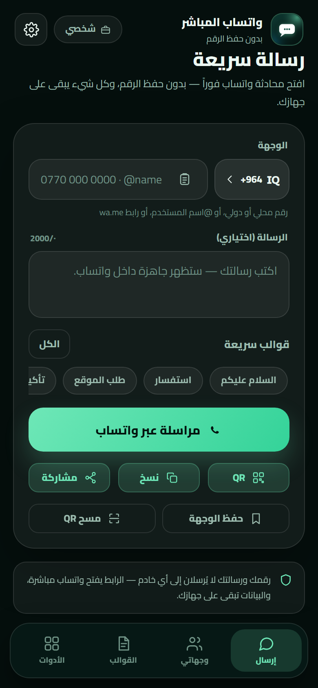 | 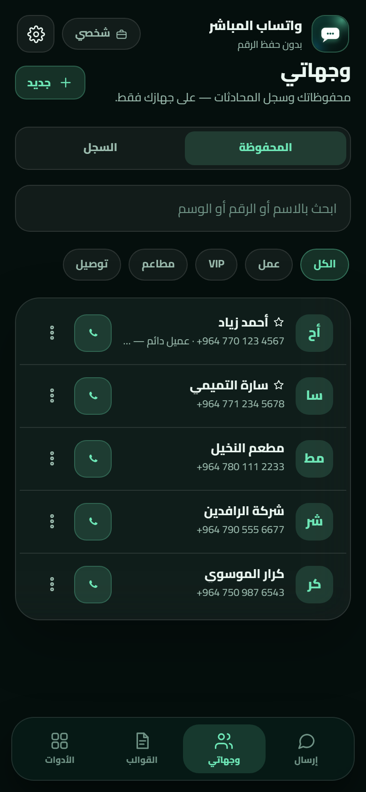 |

| دروستکردنی QR | ڕێکخستنەکان |
|---|---|
| 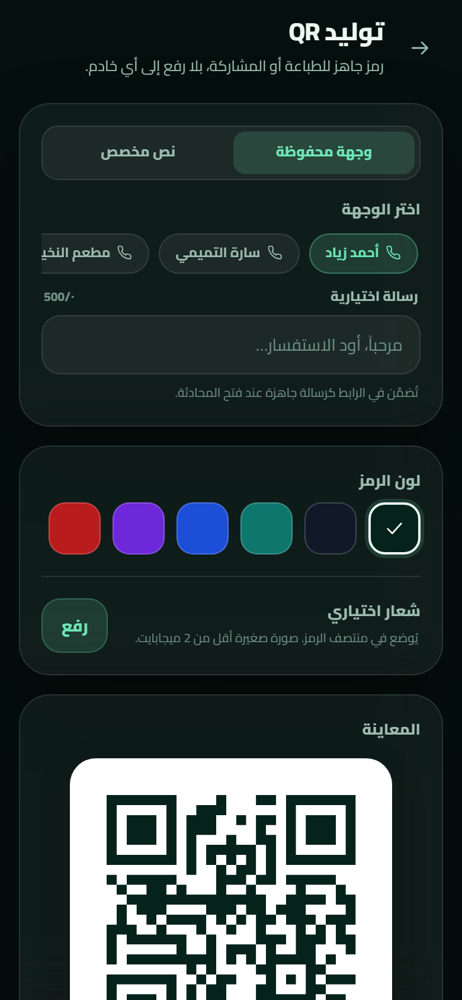 | 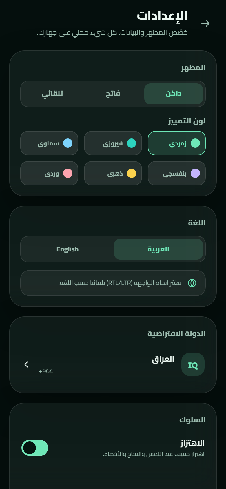 |

| ئامرازەکان | ناردن — ڕووناک |
|---|---|
| 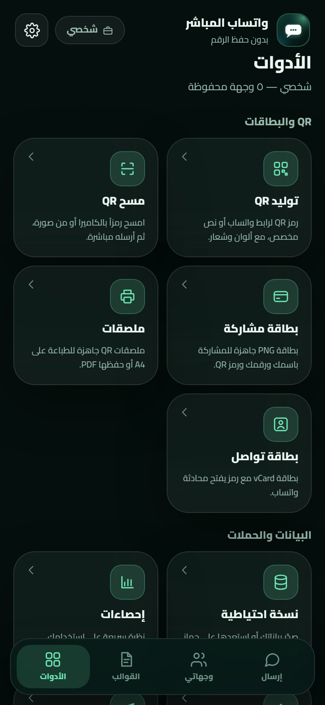 | 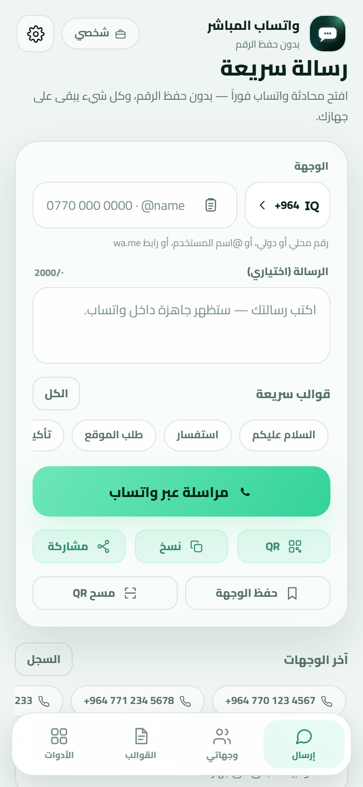 |

| گەشتی ناساندن | چی نوێیە |
|---|---|
| 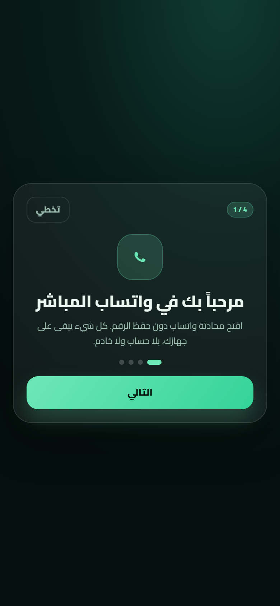 | 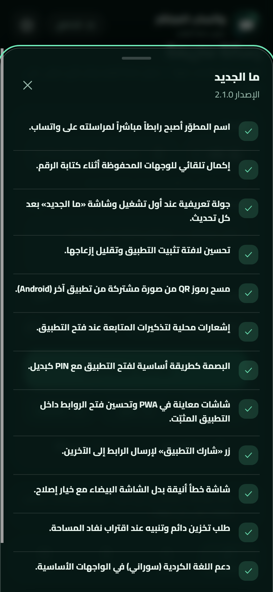 |

| ناردن بە کوردی | دەربارەی ئەپ |
|---|---|
| 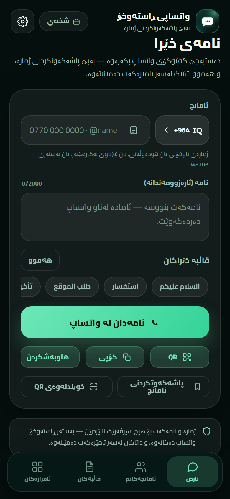 | 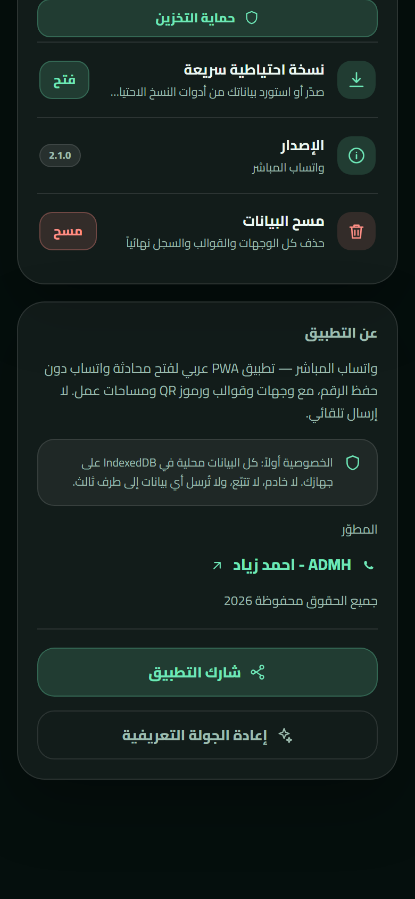 |

| ناردن بە فارسی | فۆنت — فارسی |
|---|---|
| 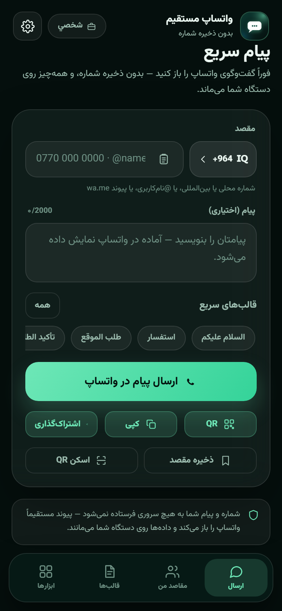 | 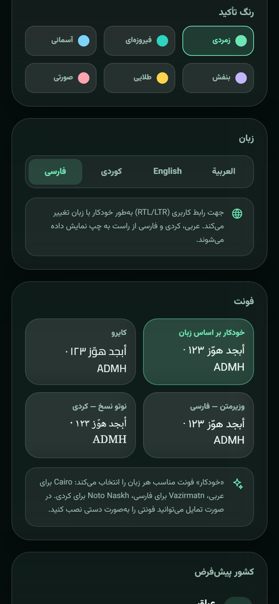 |

| گواستنەوەی داتا | پشکنینی داتا |
|---|---|
| 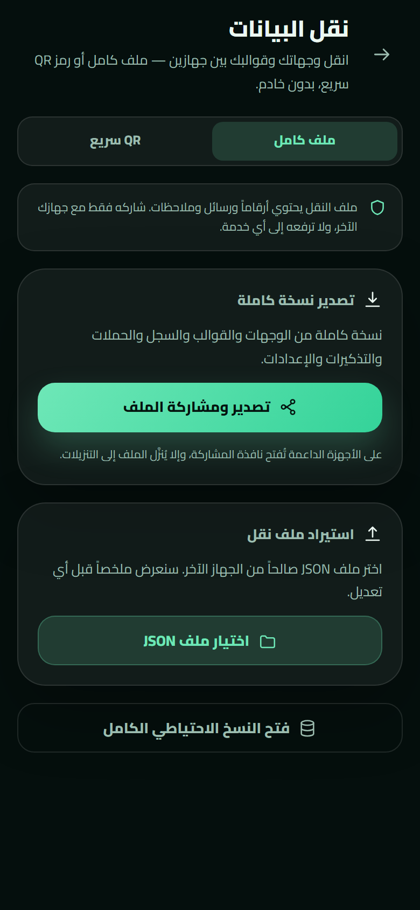 | 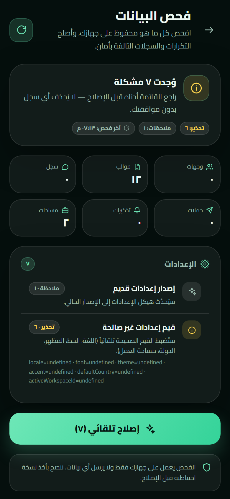 |

> شاشەکان لە وەشانی گەشەپێدان دروستکراون بە داتای تاقیکاری (`?demo=1`).

---

## تەکنەلۆژیا

| چین | هەڵبژاردن |
|---|---|
| ڕووکار | React 19 + TypeScript + Vite 6 |
| شێواز | Tailwind CSS 4 + سیستەمی دیزاینی Aurora Glass |
| فۆنتەکان | Cairo (عەرەبی/ئینگلیزی)، Vazirmatn (فارسی)، Noto Naskh Arabic (کوردی) — بە شێوەی ناوخۆیی جێگیرکراون |
| هەڵگرتن | IndexedDB لە ڕێگەی Dexie |
| QR | `qrcode` بۆ دروستکردن + `jsqr` بۆ خوێندنەوە (لەگەڵ `BarcodeDetector` کاتێک بەردەستە) |
| PWA | `vite-plugin-pwa` (injectManifest) + Workbox: precache، Share Target، ئاگادارکردنەوەکان |
| Android | Capacitor 8 + زیادکراوەکانی LocalNotifications/Camera/Clipboard/FileTransfer/FileOpener/Biometric/Share/Filesystem |
| زمانەکان | i18nی تایبەت (ar/en/ckb/fa) + دوو فەرهەنگی کوردی و فارسی کە بەپێی پێویست بار دەکرێن |
| تاقیکردنەوەکان | Vitest |

---

## کارپێکردن لە ناوخۆدا

```bash
pnpm install
pnpm dev        # http://127.0.0.1:5173
pnpm test       # تاقیکردنەوەکانی یەکە
pnpm typecheck  # پشکنینی جۆرەکان
pnpm build      # بەرهەمهێنانی dist/
pnpm preview    # پێشبینینی بەرهەم
```

> پێویستی بە Node 22+ و pnpm 9+ هەیە.
> لە دۆخی گەشەپێدان دەتوانیت داتای تاقیکاری بار بکەیت بە کردنەوەی `http://127.0.0.1:5173/?demo=1` (لە وەشانی بەرهەم نەگیراوە).

---

## پێکهاتە

```
src/
├─ App.tsx                # پێکهاتە، ڕێڕەو، قفڵ، نوێکردنەوە/دامەزراندن
├─ main.tsx
├─ components/            # پێکهاتەکانی هاوبەش (ui, icons, nav, banners)
├─ features/
│  ├─ compose/            # شاشەی ناردن
│  ├─ targets/            # ئامانجەکان و مێژوو
│  ├─ templates/          # قاڵبەکان
│  ├─ tools/              # QR، کارتەکان، لەیبڵەکان، باکئەپ، دیاگنۆستیک…
│  └─ settings/           # ڕێکخستنەکان و قفڵ
├─ lib/                   # phone, whatsapp, db, qr, scan, backup, i18n, update…
├─ hooks/                 # داواکارییە زیندووەکانی Dexie
└─ styles/                # سیستەمی دیزاین
tests/                    # Vitest
docs/                     # تایبەتمەندییەکان و پێشبینین
android/                  # پڕۆژەی Capacitor Android
```

---

## بڵاوکردنەوە لەسەر GitHub Pages

1. پرۆژەکە بۆ GitHub بپاڵنە.
2. لە **Settings → Pages** **Source: GitHub Actions** هەڵبژێرە.
3. هەر پاڵنانێک بۆ `main` فایلی `.github/workflows/deploy.yml` جێبەجێ دەکات (پشکنینی جۆرەکان + تاقیکردنەوەکان + بنیاتنان + بڵاوکردنەوە).

پرۆژەکە `base: './'` و ڕێگاکانی hash بەکاردەهێنێت، بۆیە لە ژێر ڕێگەی کۆگاکە بەبێ ڕێکخستنی زیادە کار دەکات.

---

## دروستکردنی ئەپی ئەندیڕۆید (APK)

- بە شێوەی ناوخۆیی (پێویستی بە JDK 21 + Android SDK هەیە): `pnpm android:sync` پاشان فۆڵدەری `android/` لە Android Studio بکەرەوە، یان `cd android && ./gradlew assembleRelease` لەگەڵ گۆڕاوەکانی keystore جێبەجێ بکە.
- بە شێوەی خۆکار: هەر پاڵنانێک بۆ `main` فایلی `.github/workflows/android.yml` جێبەجێ دەکات و `app-release.apk`ی واژووکراو دروست دەکات و وەک Artifact بار دەکات — **بەبێ فرۆشگا یان هەژمار**.
- APKی ئێستا **Release**ە و بە کلیلی جێگیر واژووکراوە (لە دەرەوەی کۆگا هەڵگیراوە)؛ بۆیە نوێکردنەوەکان بەسەر وەشانی ئێستا دادەمەزرێن بەبێ سڕینەوەی داتا.
- داتای ئەندیڕۆید لە PWA جیایە؛ شاشەی **گواستنەوەی داتا** یان باکئەپ بەکاربهێنە.

---

## تایبەتێتی

- بێ سێرڤەر، بێ هەژمار، بێ شیکاری، و هیچ داتایەک لە ئامێرەکەت دەرناچێت. وەشانی Android تەنها GitHub Releases بۆ پشکنین و داگرتنی نوێکردنەوە بە ڕەزامەندی تۆ دەپشکنێت.
- ژمارەکان، نامەکان، قاڵبەکان و وێنە دروستکراوەکان لەسەر ئامێرەکەت دەمێننەوە.
- کامێرا تەنها دوای داواکاری ڕوون کار دەکات و کاتێک لە شاشەکە دەردەچیت دەوەستێت.
- هیچ ژمارەیەک یان وێنەیەک بۆ خزمەتگوزاری QRی دەرەکی نانێردرێت.

---

## تاقیکردنەوەکان

- تاقیکردنەوەکانی یەکە بۆ ئاساییکردنەوە و شیکردنەوەی ژمارەکان، دروستکردنی بەستەری واتساپ، گۆڕاوەکانی قاڵب، CSV و vCard، و بەراوردکردنی وەشانی نوێکردنەوە.
- ماتریکسی تاقیکردنەوەی دەستی: Android Chrome، iOS Safari، Samsung Internet، کۆمپیوتەری سەر مێز.
- پشکنینی Lighthouse (Performance/Accessibility ≥ 95 و PWA installable) دوای بڵاوکردنەوە.

---

## مێژووی وەشانەکان

| وەشان | دیارترین شتە زیادکراوەکان |
|---|---|
| **2.4.1** | گەڕاندنەوەی دوگمەی ئامرازەکان بۆ شریتی خوارەوە بە پێنج بەش، و تێپەڕاندنی کاش بۆ پشکنینی دەستی نوێکردنەوەکان |
| **2.4.0** | بیرخستنەوەی دووبارەبوو و ئاگادارکردنەوەکان، هاوپێچی دانیشتن لەگەڵ پێشبینینی تەواو، Quick Schedule، پاککردنەوەی پارێزراوی مێژوو و سەبەتەی سڕاوەکان، و README بە چوار زمان |
| **2.4.0-beta.3** | پاککردنەوەی خۆکاری مێژوو، و سەبەتەی سڕاوەکان بە گەڕاندنەوە تا 30 ڕۆژ |
| **2.4.0-beta.2** | پێشبینینی واتساپ/کارت/لەیبڵ، دوگمەی بیرخستنەوەکان، و پشکنینی نوێکردنەوەی تەنها بە دەست |
| **2.4.0-beta.1** | هاوپێچی دانیشتن، پێشبینینی واتساپ، و Quick Schedule |
| **2.4.0-alpha.1** | بیرخستنەوەی دووبارەبوو و ئاگادارکردنەوەی ناوخۆیی، و باکئەپ پێش نوێکردنەوە |
| **2.3.5** | دوگمەی «پشکنینی نوێکردنەوە» بە دەست لە ڕێکخستنەکان لە وێب و Android |
| **2.3.4** | دوگمەی «هاوبەشکردنی ئەپ»: هەڵبژاردەی هاوبەشکردنی PWA و هەڵبژاردەی لینکی دابەزاندنی APK |
| **2.3.3** | لکاندن/کلیپبۆردی ڕەسەن، دۆخی ڕاستی هەڵگرتنی هەمیشەیی، ناردنی ڕاپۆرت بۆ گەشەپێدەر بە واتساپ، و دابەزاندنی APK بە شریتی پێشکەوتن و دوگمەی دامەزراندن |
| **2.3.2** | قفڵی پەنجەمۆری ڕەسەن لە Android لەگەڵ PINی بەدیل، و پشکنەری نوێکردنەوەی APK لەناو ئەپ |
| **2.3.1** | چاککردنەوەی Android: دیاگنۆستیکی ئەپی ڕەسەن، هاوبەشکردنی ڕەسەن، و واژووی جێگیری APK |
| **2.3.0** | گواستنەوەی داتا بە پەڕگە/QR، پشکنین و چاککردنی داتا، دیاگنۆستیک و ماتریکسی تاقیکردنەوەی ئامێرەکان، ئەپی Android APK (Capacitor) |
| **2.2.0** | زمانی فارسی، فۆنت بۆ هەر زمانێک (Cairo/Vazirmatn/Noto Naskh)، READMEی فرەزمان |
| **2.1.0** | بەستەری گەشەپێدەر، تەواوکردنی خۆکار، گەشتی ناساندن و «چی نوێیە»، QR لە وێنەی هاوبەشکراو، ئاگادارکردنەوەکانی بیرخستنەوە، پەنجەمۆر سەرەتا، شاشەکانی PWA، پاراستنی هەڵگرتن، کوردیی سۆرانی |
| **2.0.0** | بنیاتنانەوەی تەواو: React + PWA، Aurora Glass، Cairo، بێ سێرڤەر، Share Target، ئۆفلاین، باکئەپ، شوێنەکانی کار |
| **1.0.0** | یەکەم وەشانی جێگیر (HTML/JS) |

---

## بەڵگەنامەکان

- [تایبەتمەندییەکان و پلانی بنیاتنان](SPEC.md)
- [گرێبەستی گەشەپێدان](docs/DEV-CONTRACT.md)
- [ماتریکسی تاقیکردنەوەی ئامێرەکان](docs/DEVICE-TEST-MATRIX.md)
- [پێشبینینی ئاراستەی بینراو](docs/mockups/design-directions.png)

---

## لای سێیەم

فۆنتەکانی Cairo و Vazirmatn و Noto Naskh Arabic (OFL) — `qrcode` (MIT) — `jsQR` (Apache-2.0) — React/Vite/Dexie/Tailwind (MIT) — Capacitor و زیادکراوەکانی (MIT) — `@capgo/capacitor-native-biometric` (MPL-2.0). وردەکاری لە [THIRD-PARTY-NOTICES.md](THIRD-PARTY-NOTICES.md).

---

## گەشەپێدەر

<div align="center">

**ADMH - Ahmed Zeyad**

[GitHub](https://github.com/ahmdze) · [WhatsApp](https://wa.me/9647723064622)

<sub>
هەموو مافەکان پارێزراون 2026<br />
بەکارهێنراوە بە<br />
<strong>Deepseek-V4.1-Flash 1017 in Deepseek HARNESS</strong><br />
<strong>Deepseek-V4.1-Pro in Deepseek HARNESS</strong><br />
پێداچوونەوەی تەکنیکی و ئەندازیاری لەلایەن<br />
<strong>Qwen 3.8-Max</strong>
</sub>

</div>
