# Direct WhatsApp — ADMH

**Languages:** [العربية](readme.md) · **English** · [کوردی](readme.ckb.md) · [فارسی](readme.fa.md)

An Arabic (RTL), mobile-first PWA: it opens a WhatsApp chat directly **without saving the number**, with saved destinations, message templates, QR codes, share cards, and printable stickers — all locally on your device, with no server and no account.

> **Version 2.2.0** — Aurora Glass identity, Cairo font for Arabic, and four languages: Arabic, English, Kurdish (Sorani), and Persian.
> The app uses a **PWA install identity** (`id: ./v2`), so anyone who installed the old version (v1) must uninstall it and install v2 once. v1 data is not lost: it migrates automatically on first launch.

---

## Features

> Each feature is prefixed with the version it was added in, so you can spot what's new at a glance.

### Basics & sending

- **(v2.0.0)** Local/international number entry, or `@username`, or a WhatsApp link, with automatic formatting and country detection.
- **(v2.1.0)** Autocomplete for saved destinations while typing.
- **(v2.0.0)** Arabic country picker (60+ countries) with search, and a saveable default country.
- **(v2.0.0)** Optional message with a character counter (2000 characters), plus quick templates.
- **(v2.0.0)** Open the chat, copy the link, and share via the Web Share API.
- **(v2.0.0)** Smart history of recent chats, and saved destinations with names, tags, notes, and favorites.
- **(v2.0.0)** Message templates that can be created and edited, with `{الاسم}` `{الجهة}` `{التاريخ}` variables.
- **(v2.0.0)** QR generation (PNG/SVG) and QR scanning with the camera or from an image (with a jsQR fallback).
- **(v2.0.0)** High-resolution PNG share card, and a vCard contact card.
- **(v2.0.0)** Dark/light/auto appearance + accent color picker.
- **(v2.1.0)** Onboarding tour on first launch and a “What's New” screen after every update.
- **(v2.2.0)** Four languages: Arabic (default), English, کوردی, فارسی — with the Kurdish/Persian dictionaries loaded only on demand.
- **(v2.2.0)** Automatic font suited to each language: Cairo for Arabic, Vazirmatn for Persian, Noto Naskh for Kurdish, with the option to set a font manually.

### Mobile experience (PWA)

- **(v2.0.0)** Bottom navigation bar, bottom sheets, subtle animations, haptics, and designed empty/loading/error states.
- **(v2.0.0)** PWA install, full offline operation, and updates approved by the user.
- **(v2.0.0)** Share Target to receive text/links from another app.
- **(v2.1.0)** Receive a **shared QR image** from another app and scan it automatically (Android).
- **(v2.0.0)** App icon shortcuts: “Quick send” and “Scan QR”.
- **(v2.0.0)** Smart paste from the clipboard, and number extraction from pasted text.
- **(v2.0.0)** Optional lock with a PIN or biometrics (WebAuthn).
- **(v2.1.0)** Biometrics as the primary unlock method, with the PIN remaining as a fallback.
- **(v2.1.0)** Local notifications for follow-up reminders when the app opens.
- **(v2.1.0)** Smarter install banner (shown on mobile only, after a delay, and hidden once installed).
- **(v2.1.0)** Preview screens in the manifest and `handle_links`/`launch_handler` to open links inside the installed app.
- **(v2.1.0)** A “Share the app” button via Web Share or link copy.
- **(v2.1.0)** A polished error screen with an option to repair the app version.
- **(v2.1.0)** Persistent storage request and a warning when space is running low.
- **(v2.0.0)** JSON backup/restore, and CSV export.

### Extra tools

- **(v2.0.0)** QR stickers for A4 printing (2×4 or 3×8 grid) — suitable for shops and restaurants.
- **(v2.0.0)** Local statistics (last 7 days, most used).
- **(v2.0.0)** Workspaces (personal/work) with full data separation.
- **(v2.0.0)** Number-list campaigns: open chats sequentially with manual “Sent/Skipped” tracking — **no automatic sending**.
- **(v2.0.0)** Follow-up reminders that appear when the app opens.
- **(v2.0.0)** Import contacts from CSV/vCard or the Contact Picker.

---

## Languages & fonts

| Language | Direction | Recommended font |
|---|---|---|
| Arabic | RTL | Cairo |
| English | LTR | Cairo |
| کوردی (Sorani) | RTL | Noto Naskh Arabic |
| فارسی | RTL | Vazirmatn |

The default font is **“Automatic per language”**, and it can be changed manually from: **Settings → Font**. These fonts were chosen so that Kurdish and Persian letters (ڕ، ڵ، ێ، ۆ، پ، چ، ژ، گ) display correctly instead of a single Arabic font that does not cover them.

---

## Screenshots

| Sending — dark | Destinations |
|---|---|
| 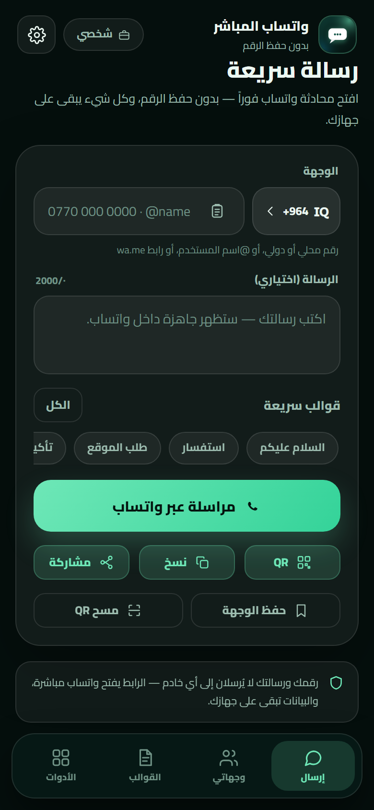 | 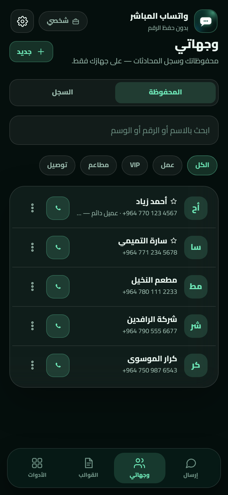 |

| QR generation | Settings |
|---|---|
| 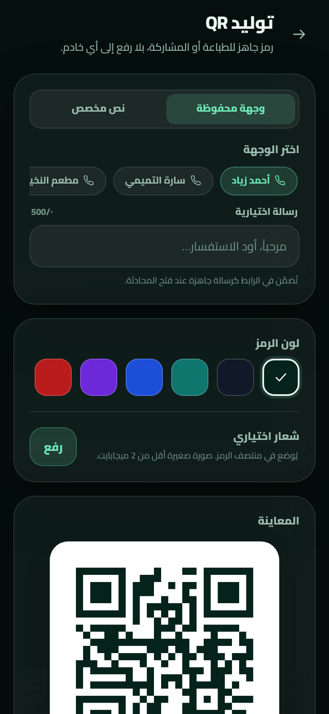 | 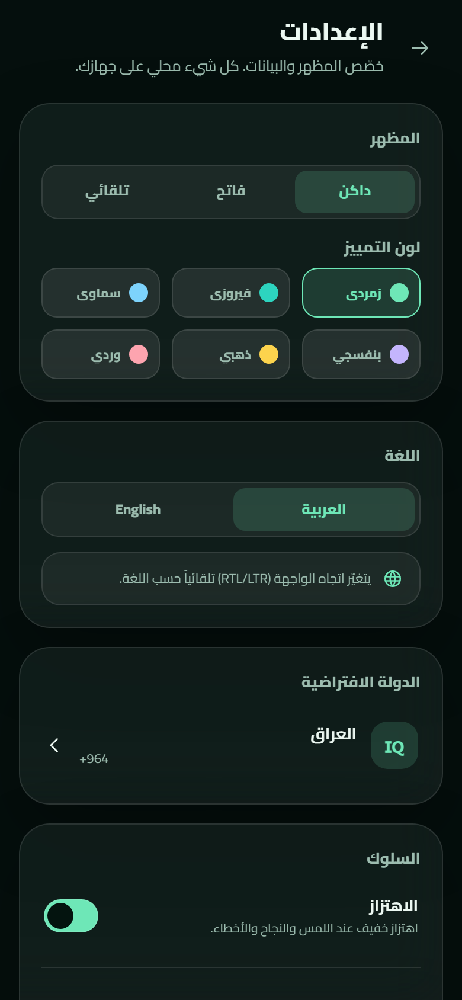 |

| Tools | Sending — light |
|---|---|
| 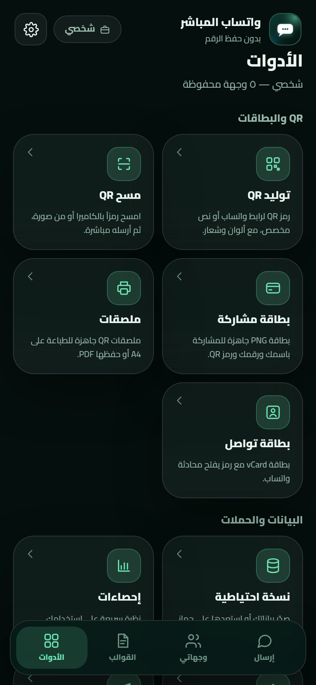 | 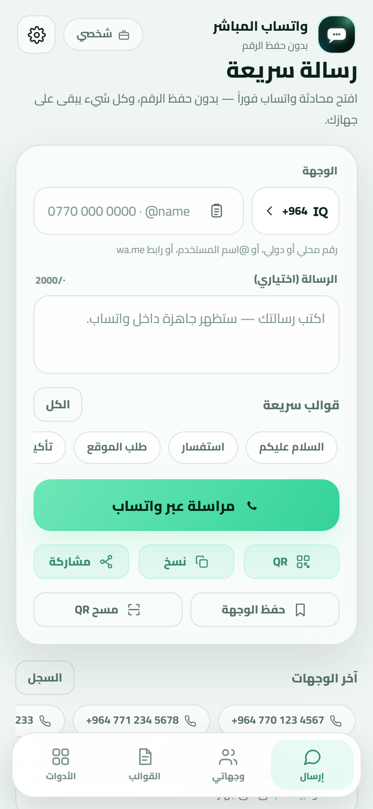 |

| Onboarding tour | What's New |
|---|---|
| 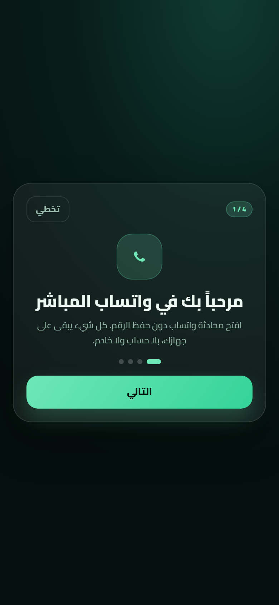 | 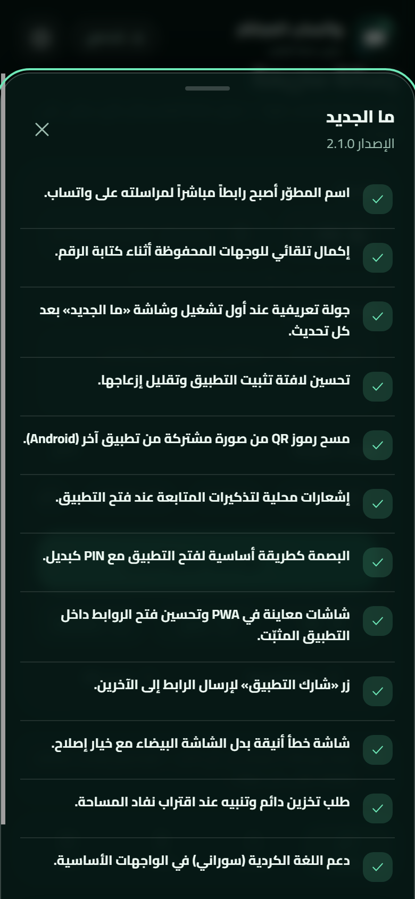 |

| Sending in Kurdish | About the app |
|---|---|
| 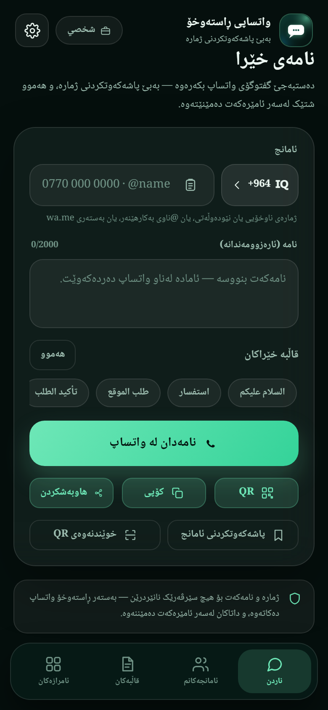 | 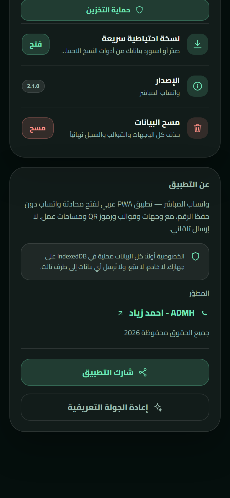 |

| Sending in Persian | Font — Persian |
|---|---|
| 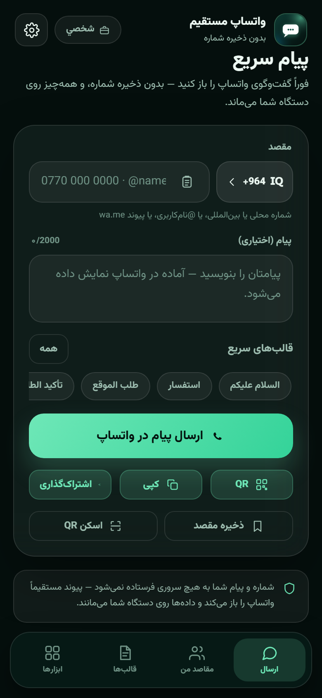 | 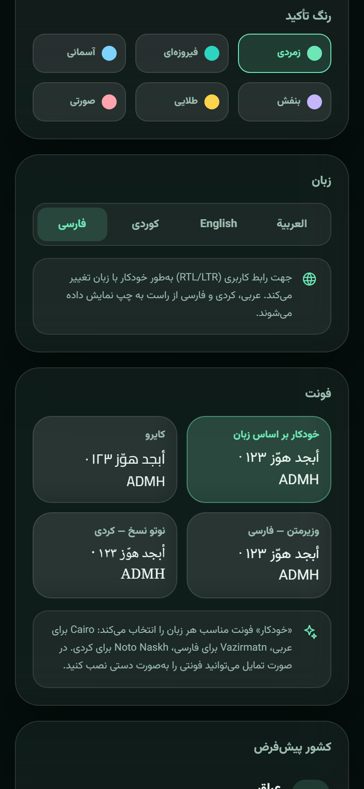 |

> Screenshots generated from the development build with demo data (`?demo=1`).

---

## Tech stack

| Layer | Choice |
|---|---|
| UI | React 19 + TypeScript + Vite 6 |
| Styling | Tailwind CSS 4 + Aurora Glass design system |
| Fonts | Cairo (Arabic/English), Vazirmatn (Persian), Noto Naskh Arabic (Kurdish) — bundled locally |
| Storage | IndexedDB via Dexie |
| QR | `qrcode` for generation + `jsqr` for reading (with `BarcodeDetector` when available) |
| PWA | `vite-plugin-pwa` (injectManifest) + Workbox: precache, Share Target for images, notifications |
| Languages | Custom i18n (ar/en/ckb/fa) + Kurdish and Persian dictionaries loaded on demand |
| Tests | Vitest |

---

## Running locally

```bash
pnpm install
pnpm dev        # http://127.0.0.1:5173
pnpm test       # unit tests
pnpm typecheck  # type checking
pnpm build      # build dist/
pnpm preview    # production preview
```

> Requires Node 22+ and pnpm 9+.
>
> In development mode you can load demo data by opening `http://127.0.0.1:5173/?demo=1` (not included in the production build).

## Structure

```
src/
├─ App.tsx                # shell, navigation, lock, update/install
├─ main.tsx
├─ components/            # shared components (ui, icons, nav, banners)
├─ features/
│  ├─ compose/            # sending screen
│  ├─ targets/            # destinations and history
│  ├─ templates/          # templates
│  ├─ tools/              # QR, cards, stickers, backup…
│  └─ settings/           # settings and lock
├─ lib/                   # phone, whatsapp, db, qr, scan, backup, i18n…
├─ hooks/                 # live Dexie queries
└─ styles/                # design system
tests/                    # Vitest
docs/                     # specs and previews
```

## Deploying to GitHub Pages

1. Push the project to GitHub.
2. In **Settings → Pages**, choose **Source: GitHub Actions**.
3. Every push to `main` runs `.github/workflows/deploy.yml` (type checking + tests + build + deploy).

The project uses `base: './'` and hash routes, so it works under a repository path without any extra configuration.

## Privacy

- No server, no account, no analytics, and no network requests after loading.
- Numbers, messages, templates, and generated images stay on your device.
- The camera only runs after an explicit request and stops when you leave the screen.
- No number or image is sent to an external QR service.

## Tests

- Unit tests for number normalization and parsing, WhatsApp link building, template variables, CSV, and vCard.
- Manual test matrix: Android Chrome, iOS Safari, Samsung Internet, desktop.
- Lighthouse check (Performance/Accessibility ≥ 95 and PWA installable) after deployment.

## Changelog

| Version | Highlights |
|---|---|
| **2.2.0** | Persian language, a font per language (Cairo/Vazirmatn/Noto Naskh), multilingual README |
| **2.1.0** | Developer link, autocomplete, onboarding tour and “What's New”, QR from a shared image, reminder notifications, biometrics first, PWA screens, storage protection, Sorani Kurdish |
| **2.0.0** | Full rebuild: React + PWA, Aurora Glass, Cairo, serverless, Share Target, offline, backup, workspaces |
| **1.0.0** | First stable release (HTML/JS) |

## Documentation

- [Specifications and build plan](SPEC.md)
- [Development contract](docs/DEV-CONTRACT.md)
- [Visual direction preview](docs/mockups/design-directions.png)

## Third party

The Cairo, Vazirmatn, and Noto Naskh Arabic fonts (OFL) — `qrcode` (MIT) — `jsQR` (Apache-2.0) — React/Vite/Dexie/Tailwind (MIT). Details in [THIRD-PARTY-NOTICES.md](THIRD-PARTY-NOTICES.md).

## Developer

[ADMH - Ahmed Ziad](https://wa.me/9647723064622) · All rights reserved 2026
