# واتساپ مستقیم — ADMH

**زبان‌ها:** [العربية](readme.md) · [English](readme.en.md) · [کوردی](readme.ckb.md) · **فارسی**

یک PWA عربی (RTL) و موبایل‌محور: گفت‌وگوی واتساپ را مستقیماً **بدون ذخیره شماره** باز می‌کند، با مقصدهای ذخیره‌شده، قالب‌های پیام، کدهای QR، کارت‌های اشتراک‌گذاری و برچسب‌های چاپی — همه به‌صورت محلی روی دستگاه شما، بدون سرور و بدون حساب.

> **نسخه 2.3.1** — انتقال داده بین دستگاه‌ها از طریق فایل/QR، بررسی و تعمیر داده‌ها، صفحه عیب‌یابی و ماتریس تست دستگاه‌ها، و **برنامه بومی اندروید (APK)** ساخته‌شده با Capacitor.
> اصلاحات 2.3.1: عیب‌یابی بومی اندروید، اشتراک‌گذاری سیستمی بومی، و امضای ثابت APK برای به‌روزرسانی‌های آینده.
> برنامه از **هویت نصب PWA** (`id: ./v2`) استفاده می‌کند، بنابراین هر کسی نسخه قدیمی (v1) را نصب کرده است باید آن را حذف کند و یک بار v2 را نصب کند. داده‌های v1 حذف نمی‌شوند: در اولین اجرا به‌طور خودکار منتقل می‌شوند.

---

## ویژگی‌ها

> هر ویژگی با شماره نسخه‌ای که در آن افزوده شده مشخص شده است تا جدیدها را به‌آسانی بشناسید.

### پایه و ارسال

- **(v2.0.0)** ورود شماره محلی/بین‌المللی، یا `@نام کاربری`، یا پیوند واتساپ، با قالب‌بندی خودکار و تشخیص کشور.
- **(v2.1.0)** تکمیل خودکار مقصدهای ذخیره‌شده هنگام تایپ.
- **(v2.0.0)** انتخابگر کشور عربی (بیش از 60 کشور) با جستجو، و کشور پیش‌فرض قابل ذخیره.
- **(v2.0.0)** پیام اختیاری با شمارنده نویسه (2000 نویسه)، و قالب‌های سریع.
- **(v2.0.0)** باز کردن گفت‌وگو، کپی پیوند، و اشتراک‌گذاری از طریق Web Share API.
- **(v2.0.0)** تاریخچه هوشمند آخرین گفت‌وگوها، و مقصدهای ذخیره‌شده با نام، برچسب، یادداشت و علاقه‌مندی‌ها.
- **(v2.0.0)** قالب‌های پیام قابل ساخت و ویرایش، با متغیرهای `{الاسم}` `{الجهة}` `{التاريخ}`.
- **(v2.0.0)** تولید QR (PNG/SVG) و خواندن QR با دوربین یا از تصویر (با جایگزین jsQR).
- **(v2.0.0)** کارت اشتراک‌گذاری PNG با کیفیت بالا، و کارت مخاطب vCard.
- **(v2.0.0)** ظاهر تیره/روشن/خودکار + انتخاب رنگ تأکیدی.
- **(v2.1.0)** تور معرفی در اولین اجرا و صفحه «چه چیز جدید است» پس از هر به‌روزرسانی.
- **(v2.2.0)** چهار زبان: عربی (پیش‌فرض)، English، کوردی، فارسی — با بارگذاری فرهنگ لغت کردی/فارسی فقط در صورت نیاز.
- **(v2.2.0)** فونت خودکار مناسب هر زبان: Cairo برای عربی، Vazirmatn برای فارسی، Noto Naskh برای کردی، با امکان تنظیم دستی فونت.

### تجربه موبایل (PWA)

- **(v2.0.0)** نوار پیمایش پایین، برگه‌های پایین، انیمیشن‌های سبک، لرزش، و حالت‌های خالی/بارگذاری/خطای طراحی‌شده.
- **(v2.0.0)** نصب PWA، کار کامل بدون اتصال، و به‌روزرسانی با تأیید کاربر.
- **(v2.0.0)** Share Target برای دریافت متن/پیوند از برنامه دیگر.
- **(v2.1.0)** دریافت **تصویر QR اشتراک‌گذاری‌شده** از برنامه دیگر و اسکن خودکار آن (اندروید).
- **(v2.0.0)** میانبرهای آیکون برنامه: «ارسال سریع» و «اسکن QR».
- **(v2.0.0)** چسباندن هوشمند از کلیپ‌بورد، و استخراج شماره از متن چسبانده‌شده.
- **(v2.0.0)** قفل اختیاری با PIN یا اثر انگشت (WebAuthn).
- **(v2.1.0)** اثر انگشت به عنوان روش اصلی باز کردن و PIN به عنوان جایگزین.
- **(v2.1.0)** اعلان‌های محلی برای یادآورهای پیگیری هنگام باز شدن برنامه.
- **(v2.1.0)** بنر نصب هوشمندتر (فقط روی موبایل نمایش داده می‌شود، با تأخیر، و پس از نصب پنهان می‌شود).
- **(v2.1.0)** صفحه‌های پیش‌نمایش در manifest و `handle_links`/`launch_handler` برای باز کردن پیوندها داخل برنامه نصب‌شده.
- **(v2.1.0)** دکمه «برنامه را به اشتراک بگذار» از طریق Web Share یا کپی پیوند.
- **(v2.1.0)** صفحه خطای شیک با گزینه تعمیر نسخه برنامه.
- **(v2.1.0)** درخواست ذخیره‌سازی دائمی و هشدار هنگام نزدیک شدن به کمبود فضا.
- **(v2.0.0)** پشتیبان‌گیری/بازیابی JSON، و خروجی CSV.

### ابزارهای بیشتر

- **(v2.0.0)** برچسب‌های QR برای چاپ روی A4 (شبکه 2×4 یا 3×8) — مناسب مغازه‌ها و رستوران‌ها.
- **(v2.0.0)** آمار محلی (7 روز اخیر، پرکاربردترین‌ها).
- **(v2.0.0)** فضاهای کاری (شخصی/کاری) با تفکیک کامل داده‌ها.
- **(v2.0.0)** کمپین‌های فهرست شماره‌ها: باز کردن گفت‌وگوها به ترتیب با پیگیری دستی «ارسال شد/رد شد» — **بدون ارسال خودکار**.
- **(v2.0.0)** یادآورهای پیگیری که هنگام باز شدن برنامه نمایش داده می‌شوند.
- **(v2.0.0)** وارد کردن مخاطبین از CSV/vCard یا Contact Picker.
- **(v2.3.0)** **انتقال داده** بین دو دستگاه از طریق فایل یا کد QR، بدون سرور.
- **(v2.3.0)** **بررسی و تعمیر داده‌های محلی** (تکرارها، شماره‌های معیوب، رکوردهای یتیم) با پیش‌نمایش پیش از تعمیر.
- **(v2.3.0)** **عیب‌یابی دستگاه** (قابلیت‌های مرورگر/دوربین/اعلان‌ها/ذخیره‌سازی) و خروجی گزارش، همراه با [ماتریس تست دستگاه‌ها](docs/DEVICE-TEST-MATRIX.md).
- **(v2.3.0)** **برنامه بومی اندروید (APK)** که در کنار PWA کار می‌کند، با اعلان‌های زمان‌بندی‌شده در پس‌زمینه و نشان/آیکون بومی.

### برنامه اندروید (APK)

- **(v2.3.0)** نسخه اندروید ساخته‌شده با Capacitor از همان کد React، مستقیماً **بدون فروشگاه یا حساب** نصب می‌شود.
- از صفحه انتشارها دانلود می‌شود: [آخرین نسخه](https://github.com/ahmdze/ADMH-DirectWhatsApp/releases/latest).
- **APK برای آزمایش/توزیع مستقیم** است و برای فروشگاه امضا نشده؛ ممکن است هنگام نصب از خارج فروشگاه هشدار Play Protect نمایش داده شود.
- داده‌های اندروید از PWA جدا هستند (مبدأ متفاوت)؛ برای انتقال آن‌ها از **انتقال داده** یا پشتیبان‌گیری استفاده کنید.
- اعلان‌های یادآور در نسخه اندروید در پس‌زمینه کار می‌کنند (دقت آن‌ها بسته به اجازه سیستم برای اعلان‌های دقیق متفاوت است).

---

## زبان‌ها و فونت‌ها

| زبان | جهت | فونت پیشنهادی |
|---|---|---|
| عربی | RTL | Cairo |
| English | LTR | Cairo |
| کوردی (سورانی) | RTL | Noto Naskh Arabic |
| فارسی | RTL | Vazirmatn |

فونت پیش‌فرض **«خودکار بر اساس زبان»** است و می‌توان آن را به‌صورت دستی از: **تنظیمات → فونت** تغییر داد. این فونت‌ها طراحی شده‌اند تا حروف کردی و فارسی (ڕ، ڵ، ێ، ۆ، پ، چ، ژ، گ) را به‌درستی نمایش دهند، به جای یک فونت عربی واحد که آن‌ها را پوشش نمی‌دهد.

---

## تصاویر برنامه

| ارسال — تیره | مقصدها |
|---|---|
| 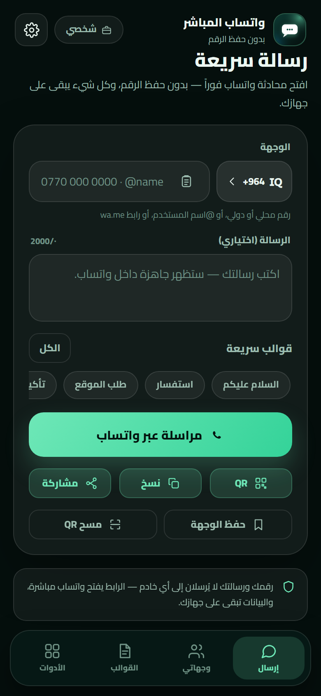 | 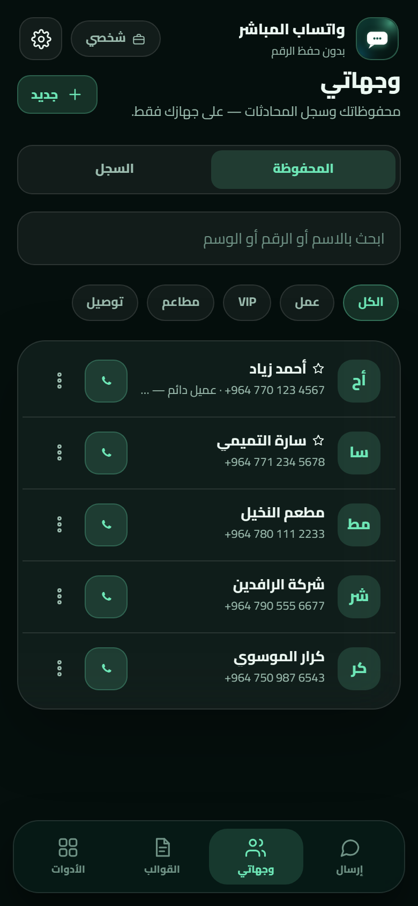 |

| تولید QR | تنظیمات |
|---|---|
| 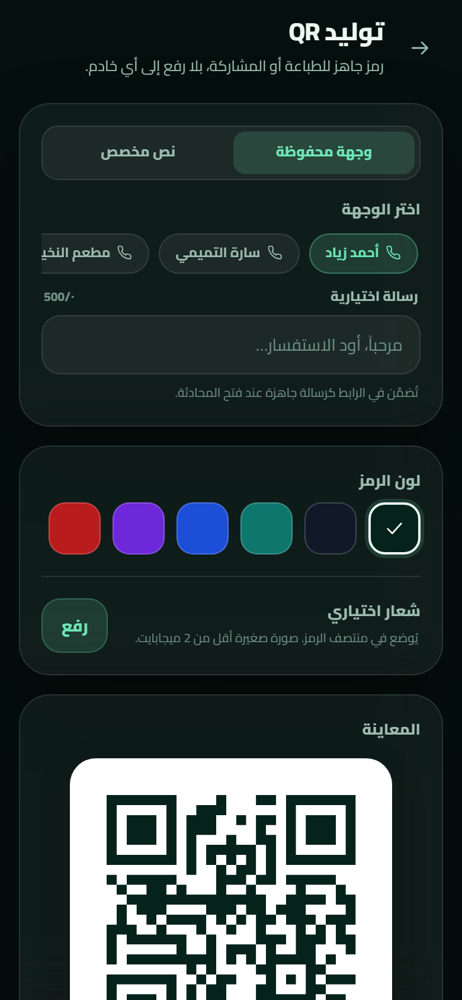 | 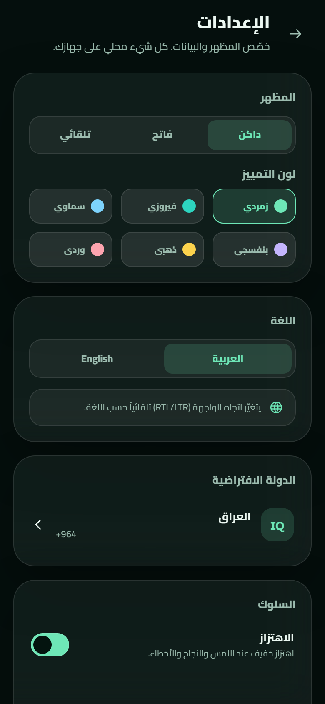 |

| ابزارها | ارسال — روشن |
|---|---|
| 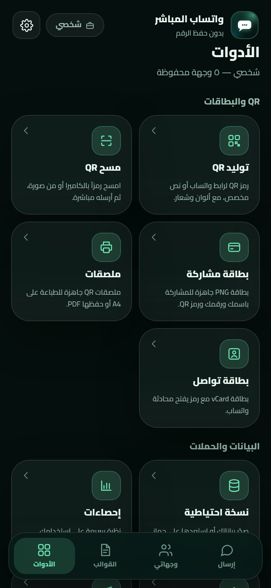 | 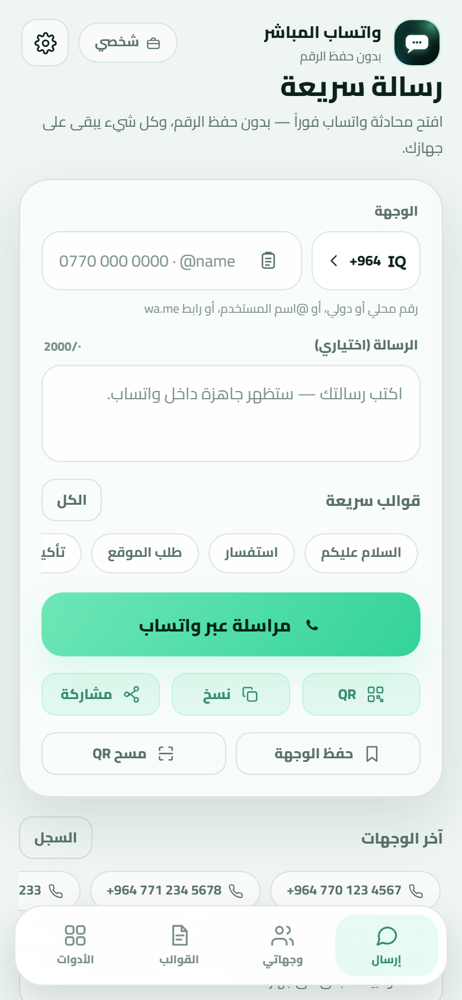 |

| تور معرفی | چه چیز جدید است |
|---|---|
| 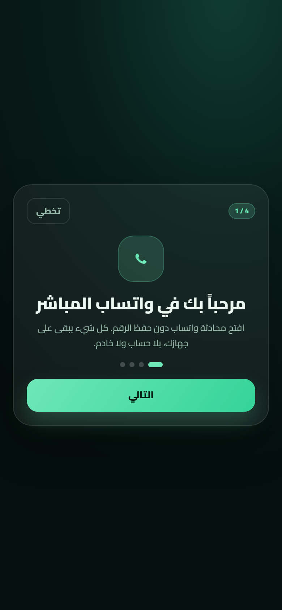 | 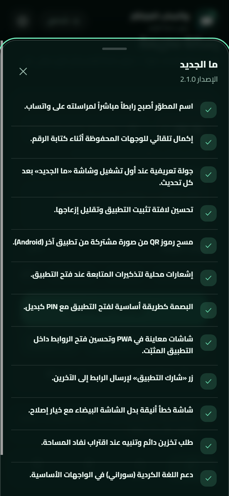 |

| ارسال به کردی | درباره برنامه |
|---|---|
| 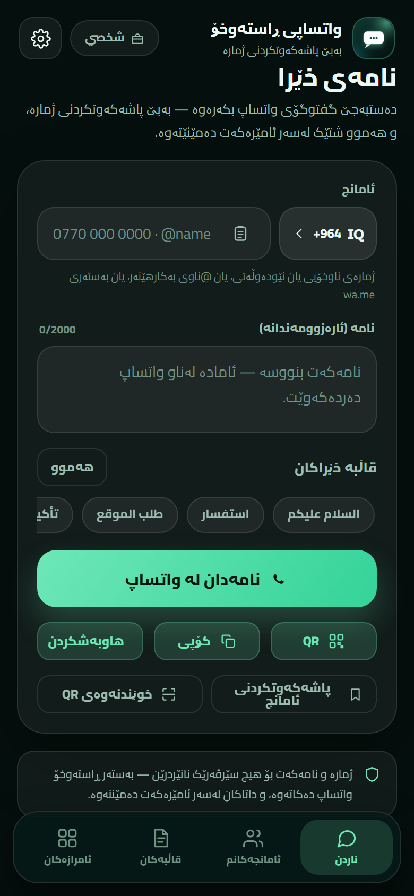 | 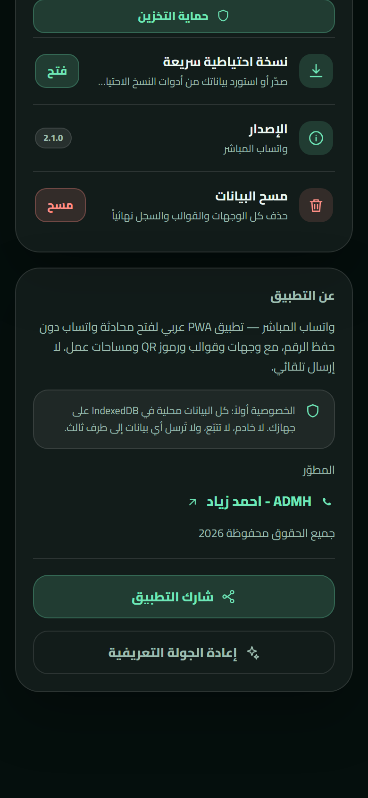 |

| ارسال به فارسی | فونت — فارسی |
|---|---|
| 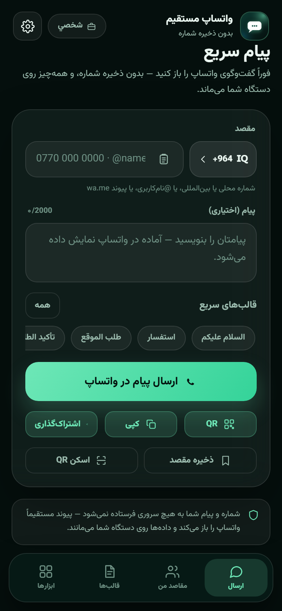 | 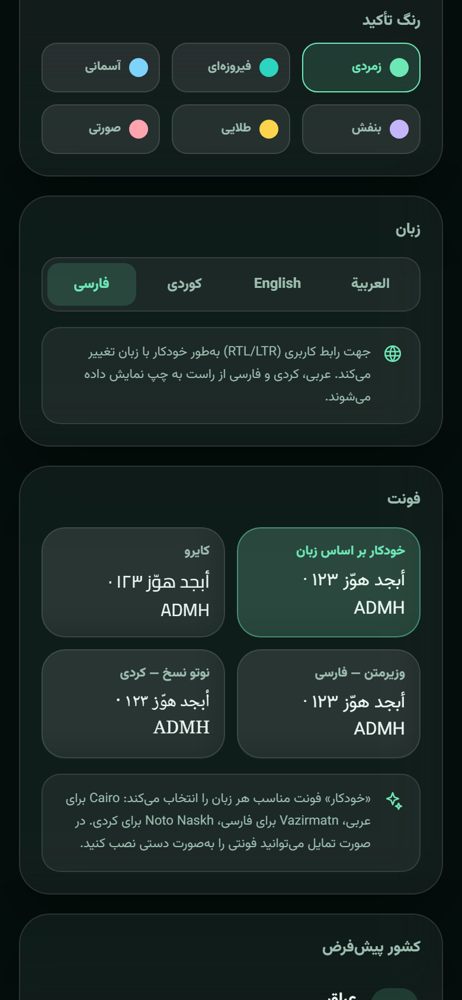 |

| انتقال داده | سلامت داده |
|---|---|
| 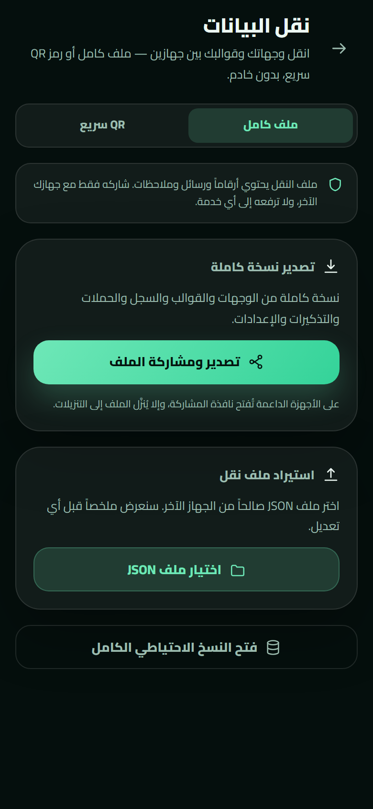 | 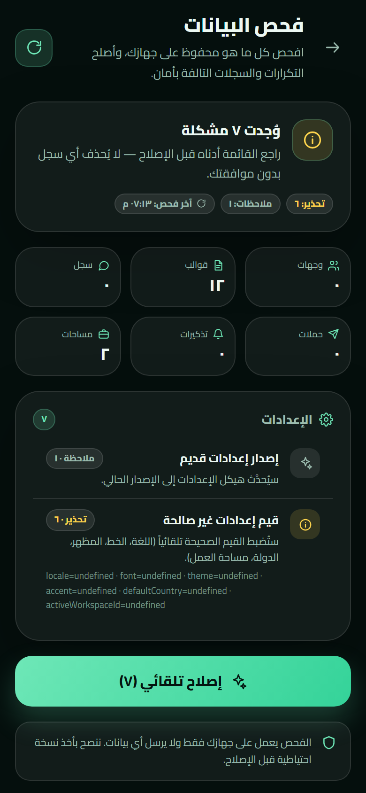 |

> تصاویر از نسخه توسعه با داده‌های آزمایشی (`?demo=1`) تولید شده‌اند.

---

## فناوری

| لایه | انتخاب |
|---|---|
| رابط کاربری | React 19 + TypeScript + Vite 6 |
| استایل‌دهی | Tailwind CSS 4 + سیستم طراحی Aurora Glass |
| فونت‌ها | Cairo (عربی/انگلیسی)، Vazirmatn (فارسی)، Noto Naskh Arabic (کردی) — جاسازی‌شده به‌صورت محلی |
| ذخیره‌سازی | IndexedDB از طریق Dexie |
| QR | `qrcode` برای تولید + `jsqr` برای خواندن (با `BarcodeDetector` در صورت وجود) |
| PWA | `vite-plugin-pwa` (injectManifest) + Workbox: precache، Share Target برای تصاویر، اعلان‌ها |
| اندروید | Capacitor 8 + افزونه‌های LocalNotifications/Camera/Share/Filesystem/App/Haptics — APK ساخته‌شده در CI |
| زبان‌ها | i18n سفارشی (ar/en/ckb/fa) + دو فرهنگ لغت کردی و فارسی که در صورت نیاز بارگذاری می‌شوند |
| تست‌ها | Vitest |

---

## اجرا به‌صورت محلی

```bash
pnpm install
pnpm dev        # http://127.0.0.1:5173
pnpm test       # تست‌های واحد
pnpm typecheck  # بررسی انواع
pnpm build      # تولید dist/
pnpm preview    # پیش‌نمایش نسخه تولید
```

> به Node 22+ و pnpm 9+ نیاز دارد.
>
> در حالت توسعه می‌توانید با باز کردن `http://127.0.0.1:5173/?demo=1` داده‌های آزمایشی بارگذاری کنید (در نسخه تولید گنجانده نمی‌شود).

## ساختار

```
src/
├─ App.tsx                # ساختار، پیمایش، قفل، به‌روزرسانی/نصب
├─ main.tsx
├─ components/            # اجزای مشترک (ui, icons, nav, banners)
├─ features/
│  ├─ compose/            # صفحه ارسال
│  ├─ targets/            # مقصدها و تاریخچه
│  ├─ templates/          # قالب‌ها
│  ├─ tools/              # QR، کارت‌ها، برچسب‌ها، پشتیبان‌گیری…
│  └─ settings/           # تنظیمات و قفل
├─ lib/                   # phone, whatsapp, db, qr, scan, backup, i18n…
├─ hooks/                 # کوئری‌های زنده Dexie
└─ styles/                # سیستم طراحی
tests/                    # Vitest
docs/                     # مشخصات و پیش‌نمایش
```

## انتشار در GitHub Pages

1. پروژه را روی GitHub بارگذاری کنید.
2. در **Settings → Pages** گزینه **Source: GitHub Actions** را انتخاب کنید.
3. هر push به `main` فایل `.github/workflows/deploy.yml` را اجرا می‌کند (بررسی انواع + تست‌ها + ساخت + انتشار).

پروژه از `base: './'` و مسیرهای hash استفاده می‌کند، بنابراین بدون تنظیم اضافی زیر مسیر مخزن کار می‌کند.

## ساخت برنامه اندروید (APK)

- به‌صورت محلی (نیازمند JDK 21 + Android SDK): `pnpm android:sync` سپس پوشه `android/` را در Android Studio باز کنید و APK بسازید، یا `cd android && ./gradlew assembleDebug` را اجرا کنید.
- به‌صورت خودکار: هر push به `main` فایل `.github/workflows/android.yml` را اجرا می‌کند، `app-debug.apk` را می‌سازد و به‌عنوان Artifact بارگذاری می‌کند — **بدون فروشگاه یا حساب**.
- APK فعلی **Debug** است برای آزمایش/توزیع مستقیم؛ برای به‌روزرسانی بلندمدت بعداً یک keystore ثابت ساخته می‌شود (در مخزن بارگذاری نمی‌شود).
- داده‌های اندروید از PWA جدا هستند؛ از صفحه **انتقال داده** یا پشتیبان‌گیری استفاده کنید.

## حریم خصوصی

- بدون سرور، بدون حساب، بدون تحلیل، و بدون درخواست شبکه پس از بارگذاری.
- شماره‌ها، پیام‌ها، قالب‌ها و تصاویر تولیدشده روی دستگاه شما می‌مانند.
- دوربین فقط پس از درخواست صریح کار می‌کند و هنگام خروج از صفحه متوقف می‌شود.
- هیچ شماره یا تصویری به سرویس QR خارجی ارسال نمی‌شود.

## تست‌ها

- تست‌های واحد برای نرمال‌سازی و تجزیه شماره‌ها، ساخت پیوند واتساپ، متغیرهای قالب، CSV و vCard.
- ماتریس تست دستی: Android Chrome، iOS Safari، Samsung Internet، دسکتاپ.
- بررسی Lighthouse (Performance/Accessibility ≥ 95 و قابلیت نصب PWA) پس از انتشار.

## تاریخچه نسخه‌ها

| نسخه | مهم‌ترین افزوده‌ها |
|---|---|
| **2.3.1** | اصلاحات اندروید: عیب‌یابی برنامه بومی، اشتراک‌گذاری بومی، و امضای ثابت APK |
| **2.3.0** | انتقال داده از طریق فایل/QR، بررسی و تعمیر داده‌ها، عیب‌یابی و ماتریس تست دستگاه‌ها، برنامه Android APK (Capacitor) |
| **2.2.0** | زبان فارسی، فونت برای هر زبان (Cairo/Vazirmatn/Noto Naskh)، README چندزبانه |
| **2.1.0** | پیوند توسعه‌دهنده، تکمیل خودکار، تور معرفی و «چه چیز جدید است»، QR از تصویر اشتراکی، اعلان‌های یادآور، اثر انگشت اول، صفحه‌های PWA، محافظت از ذخیره‌سازی، کردی سورانی |
| **2.0.0** | بازسازی کامل: React + PWA، Aurora Glass، Cairo، بدون سرور، Share Target، آفلاین، پشتیبان‌گیری، فضاهای کاری |
| **1.0.0** | اولین نسخه پایدار (HTML/JS) |

## مستندات

- [مشخصات و برنامه ساخت](SPEC.md)
- [قرارداد توسعه](docs/DEV-CONTRACT.md)
- [پیش‌نمایش جهت بصری](docs/mockups/design-directions.png)

## شخص ثالث

فونت‌های Cairo و Vazirmatn و Noto Naskh Arabic (OFL) — `qrcode` (MIT) — `jsQR` (Apache-2.0) — React/Vite/Dexie/Tailwind (MIT). جزئیات در [THIRD-PARTY-NOTICES.md](THIRD-PARTY-NOTICES.md).

## توسعه‌دهنده

[ADMH - احمد زیاد](https://wa.me/9647723064622) · کلیه حقوق محفوظ است 2026
