<div align="center">


<h1>واتساب المباشر <sub>ADMH Direct WhatsApp</sub></h1>

<p>
افتح محادثة واتساب مباشرة <strong>بدون حفظ الرقم</strong> — وجهات وقوالب ورموز QR وبطاقات وملصقات،<br />
كل شيء محلي على جهازك: بلا خادم، بلا حساب، وبلا إرسال تلقائي.
</p>

<p>
<a href="https://github.com/ahmdze/ADMH-DirectWhatsApp/releases/tag/v2.4.0-beta.3"></a>
&nbsp;

&nbsp;

</p>

<p>
<a href="https://github.com/ahmdze"><strong>ADMH - Ahmed Zeyad</strong></a><br />
<sub>
تم التطوير باستخدام<br />
<strong>Deepseek-V4.1-Flash 1017 in Deepseek HARNESS</strong><br />
<strong>Deepseek-V4.1-Pro in Deepseek HARNESS</strong><br />
<br />
المراجعة التقنية والفنية بواسطة<br />
<strong>Qwen 3.8-Max</strong><br />

</sub>
</p>

<p><strong>هذا الملف متوفر بأربع لغات:</strong></p>

<table>
  <tr>
    <td align="center"><a href="readme.md"></a></td>
    <td align="center"><a href="readme.en.md"></a></td>
    <td align="center"><a href="readme.ckb.md"></a></td>
    <td align="center"><a href="readme.fa.md"></a></td>
  </tr>
</table>

</div>

---

## المحتويات

| ابدأ | استكشف | تقني | المزيد |
|---|---|---|---|
| [عن التطبيق](#عن-التطبيق) | [الميزات](#الميزات) | [التقنية](#التقنية) | [الخصوصية](#الخصوصية) |
| [ابدأ الآن](#ابدأ-الآن) | [لقطات التطبيق](#لقطات-من-التطبيق) | [التشغيل محلياً](#التشغيل-محلياً) | [سجل الإصدارات](#سجل-الإصدارات) |
| [تطبيق Android](#تطبيق-android-apk) | [اللغات والخطوط](#اللغات-والخطوط) | [بناء APK](#بناء-تطبيق-android-apk) | [الوثائق](#وثائق) |

---

## عن التطبيق

**واتساب المباشر** تطبيق ويب تقدمي (PWA) عربي (RTL) مصمم للهاتف، ونسخة Android أصلية مبنية بـCapacitor:

- يفتح محادثة واتساب فوراً برقم محلي/دولي أو `@اسم مستخدم` أو رابط `wa.me`.
- يحفظ الوجهات والقوالب وسجل المحادثات في مساحات عمل منفصلة.
- يولّد QR ويقرأه من الكاميرا أو الصورة، ويصنع بطاقات مشاركة وملصقات طباعة.
- يعمل بالكامل دون اتصال بعد أول تحميل، وبياناته في IndexedDB على جهازك.

> [!IMPORTANT]
> أحدث إصدار هو **2.4.0-beta.3** (Beta داخلية للتجريب). تطبيق Android يُثبَّت مباشرة بملف APK موقّع، وليس عبر متجر.
> من ثبّت نسخة v1 القديمة يحتاج حذفها وتثبيت v2 مرة واحدة؛ بيانات v1 تُرحَّل تلقائياً.

> [!NOTE]
> لا يوجد إرسال تلقائي للرسائل أو فتح محادثات في الخلفية. التطبيق أداة اختصار وفتح مباشر، وأنت من يرسل.

---

## ابدأ الآن

| 🌐 نسخة الويب (PWA) | 🤖 نسخة Android (APK) |
|---|---|
| [فتح التطبيق من المتصفح](https://ahmdze.github.io/ADMH-DirectWhatsApp/) | [تحميل أحدث APK](https://github.com/ahmdze/ADMH-DirectWhatsApp/releases/latest) |
| تعمل على Android وiOS وسطح المكتب، وتُثبَّت من قائمة المتصفح. | ملف موقّع للتوزيع المباشر، يعمل بجانب PWA وتحديثاته داخلية. |

---

## الميزات

> رقم الإصدار الذي أُضيفت فيه الميزة يظهر كبطاقة ملوّنة في نهاية كل سطر.

### الأساس والإرسال

- إدخال رقم محلي/دولي أو `@اسم مستخدم` أو رابط واتساب، مع تنسيق تلقائي وكشف الدولة. 
- إكمال تلقائي للوجهات المحفوظة أثناء الكتابة. 
- منتقي دولة عربي (60+ دولة) مع بحث، ودولة افتراضية قابلة للحفظ. 
- رسالة اختيارية مع عدّاد أحرف (2000 حرف)، وقوالب سريعة. 
- فتح المحادثة، نسخ الرابط، والمشاركة عبر Web Share API. 
- سجل ذكي لآخر المحادثات، ووجهات محفوظة بأسماء ووسوم وملاحظات ومفضلة. 
- قوالب رسائل قابلة للإنشاء والتعديل، مع متغيّرات `{الاسم}` `{الجهة}` `{التاريخ}`. 
- توليد QR (PNG/SVG) وقراءة QR بالكاميرا أو من صورة (مع بديل jsQR). 
- بطاقة مشاركة PNG عالية الدقة، وبطاقة تواصل vCard. 
- مظهر داكن/فاتح/تلقائي + اختيار لون التمييز. 
- جولة تعريفية عند أول تشغيل وشاشة «ما الجديد» بعد كل تحديث. 
- أربع لغات: العربية (افتراضية)، English، کوردی، فارسی — مع تحميل قاموس الكردية/الفارسية عند الطلب فقط. 
- خط تلقائي مناسب لكل لغة: Cairo للعربية، Vazirmatn للفارسية، Noto Naskh للكردية، مع إمكانية تثبيت خط يدوياً. 
- لصق ذكي من الحافظة الأصلية في Android، واستخراج رقم من نص ملصوق. 
- زر «شارك التطبيق» بخيارين: مشاركة تطبيق PWA أو رابط تنزيل APK. 
- **مرفقات جلسة محلية**: صور وملفات وvCard تُشارك عبر نافذة النظام ولا تُخزَّن في التطبيق، مع ضغط صور WebP وبديل تنزيل. 
- **معاينة قبل الإرسال** بنمط واتساب، وبطاقة مشاركة، وملصق QR — كلها محلياً ودون جلب روابط. 
- **جدولة سريعة** لتذكير من Compose بالوجهة والرسالة الحالية. 

### تجربة الهاتف (PWA)

- شريط تنقّل سفلي، أوراق سفلية، حركات خفيفة، اهتزاز، وحالات فارغة/تحميل/أخطاء مصممة. 
- تثبيت PWA، عمل كامل دون اتصال، وتحديث بموافقة المستخدم. 
- Share Target لاستقبال نص/رابط من تطبيق آخر. 
- استقبال **صورة QR مشتركة** من تطبيق آخر ومسحها تلقائياً (Android). 
- اختصارات أيقونة التطبيق: «إرسال سريع» و«مسح QR». 
- قفل اختياري بـPIN أو بصمة (WebAuthn). 
- البصمة كطريقة فتح أساسية مع بقاء PIN كبديل. 
- إشعارات محلية لتذكيرات المتابعة عند فتح التطبيق. 
- لافتة تثبيت أذكى (تظهر على الهاتف فقط، بعد تأخير، وتُخفى بعد التثبيت). 
- شاشات معاينة في manifest و`handle_links`/`launch_handler` لفتح الروابط داخل التطبيق المثبّت. 
- شاشة خطأ أنيقة مع خيار إصلاح نسخة التطبيق. 
- طلب تخزين دائم وتنبيه عند اقتراب نفاد المساحة. 
- نسخ احتياطي/استعادة JSON، وتصدير CSV. 
- نقل البيانات بين جهازين عبر ملف أو QR، وفحص وإصلاح البيانات، وتشخيص الجهاز. 
- زر **«فحص التحديثات»** يدوي فقط في الإعدادات: لا يوجد فحص تلقائي في الخلفية، حفاظاً على الخصوصية وتقليل الطلبات. 
- **زر التذكيرات** في شريط التنقل السفلي للوصول بضغطة واحدة. 

### الأدوات والبيانات

- ملصقات QR للطباعة على A4 (شبكة 2×4 أو 3×8) — مناسبة للمتاجر والمطاعم. 
- إحصاءات محلية (آخر 7 أيام، الأكثر استخداماً). 
- مساحات عمل (شخصي/عمل) مع فصل كامل للبيانات. 
- حملات قائمة أرقام: فتح المحادثات بالتتابع مع متابعة يدوية «أُرسلت/تخطيت» — **لا إرسال تلقائي**. 
- تذكيرات متابعة تظهر عند فتح التطبيق. 
- **تذكيرات متكررة** (يومي/أسبوعي/شهري) مع إشعارات محلية وجدولة في Android، وفتح Compose من الإشعار. 
- **نسخة احتياطية تلقائية قبل الترقية**، قابلة للتنزيل من الإعدادات. 
- استيراد جهات من CSV/vCard أو Contact Picker. 
- **نقل البيانات** بين جهازين عبر ملف أو رمز QR، بدون خادم. 
- **فحص وإصلاح البيانات** المحلية (تكرارات، أرقام تالفة، سجلات يتيمة) مع معاينة قبل الإصلاح. 
- **تنظيف تلقائي للسجل وسلة محذوفات**: حذف تلقائي لسجل المحادثات القديم، وسلة محذوفات تتيح استعادة العناصر حتى 30 يوماً. 
- **تشخيص الجهاز** (قدرات المتصفح/الكاميرا/الإشعارات/التخزين) وتصدير تقرير، مع [مصفوفة اختبار الأجهزة](docs/DEVICE-TEST-MATRIX.md). 
- **إرسال إلى المطوّر** من التشخيص: يفتح واتساب مع التقرير الكامل. 
- **تطبيق Android أصلي (APK)** يعمل بجانب PWA، مع إشعارات مجدولة في الخلفية، وشارة/أيقونة أصلية. 
- **قفل بالبصمة الأصلية** في Android، مع بقاء PIN بديلاً دائماً. 
- **فاحص تحديث APK** داخل التطبيق، مع تنزيل داخلي بشريط تقدم ثم زر تثبيت. 

---

## اللغات والخطوط

| اللغة | الاتجاه | الخط الموصى به |
|---|---|---|
| العربية | RTL | Cairo |
| English | LTR | Cairo |
| کوردی (سورانی) | RTL | Noto Naskh Arabic |
| فارسی | RTL | Vazirmatn |

الخط الافتراضي هو **«تلقائي حسب اللغة»**، ويمكن تغييره يدوياً من: **الإعدادات → الخط**. صُمّمت هذه الخطوط لتُظهر الحروف الكردية والفارسية (ڕ، ڵ، ێ، ۆ، پ، چ، ژ، گ) بشكل صحيح بدل خط عربي واحد لا يغطيها.

---

## لقطات من التطبيق

| الإرسال — داكن | الوجهات |
|---|---|
| 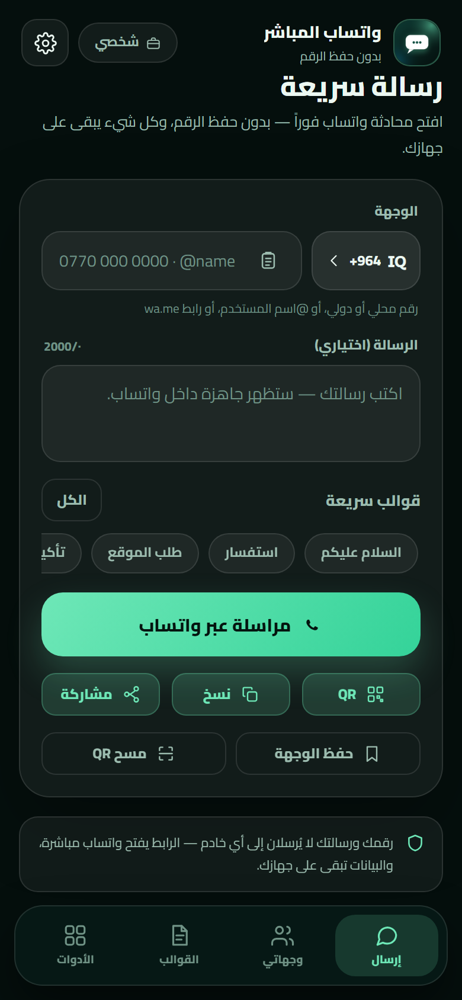 | 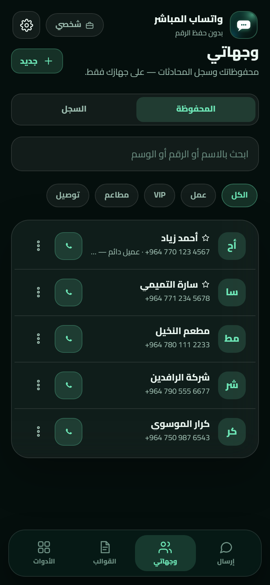 |

| توليد QR | الإعدادات |
|---|---|
| 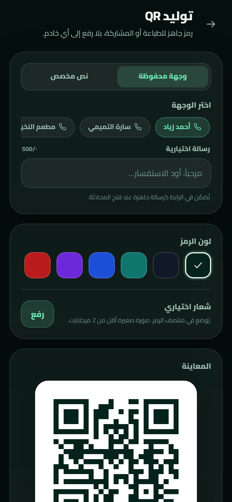 | 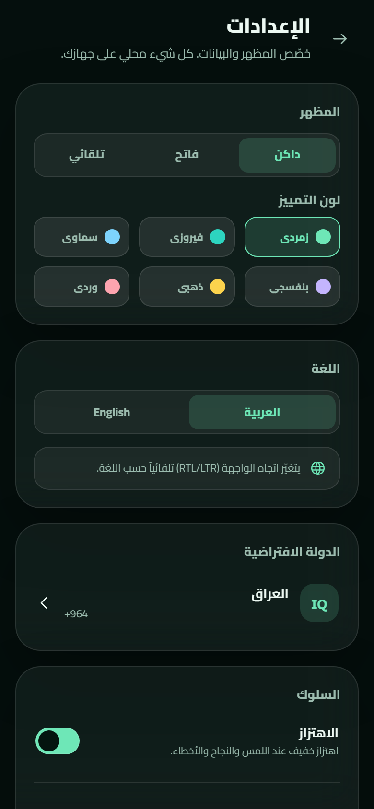 |

| الأدوات | الإرسال — فاتح |
|---|---|
| 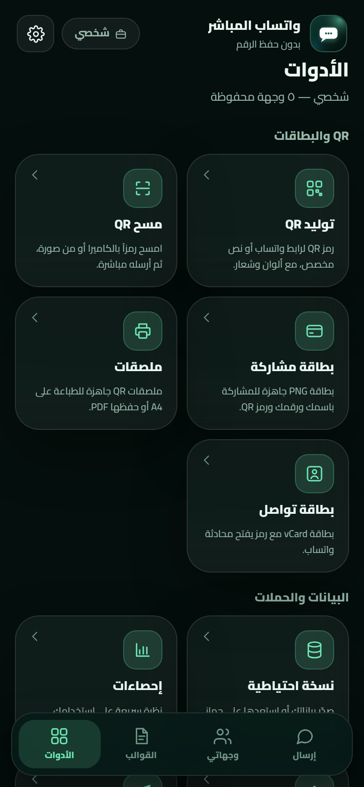 | 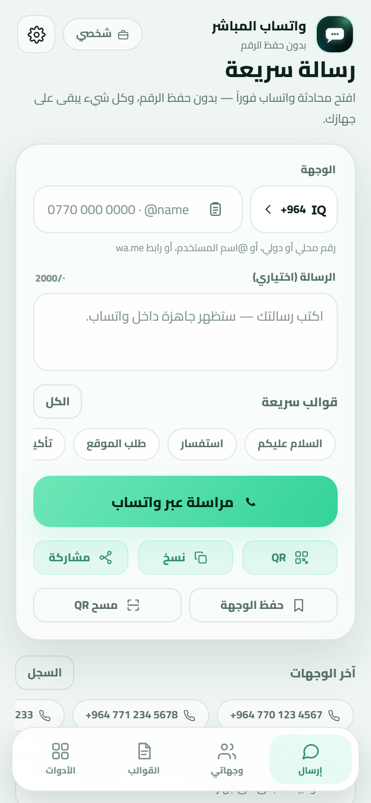 |

| الجولة التعريفية | ما الجديد |
|---|---|
| 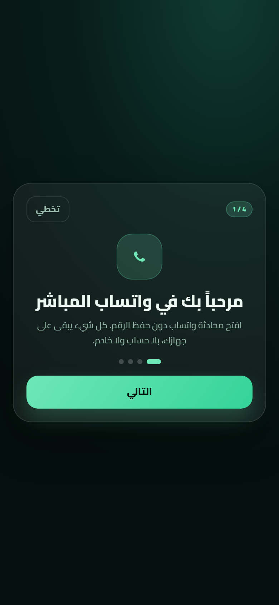 | 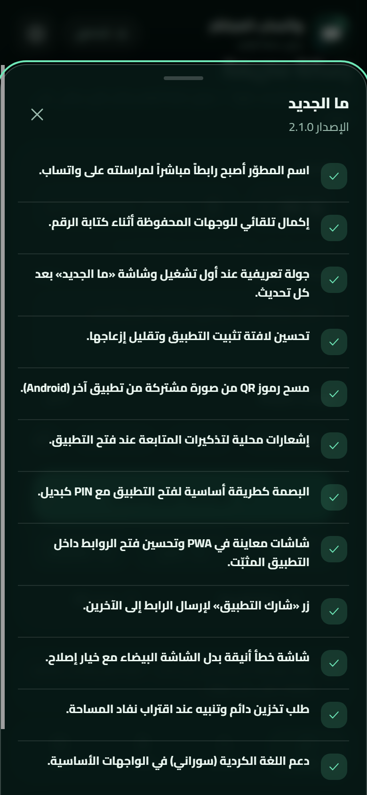 |

| الإرسال بالكردية | عن التطبيق |
|---|---|
| 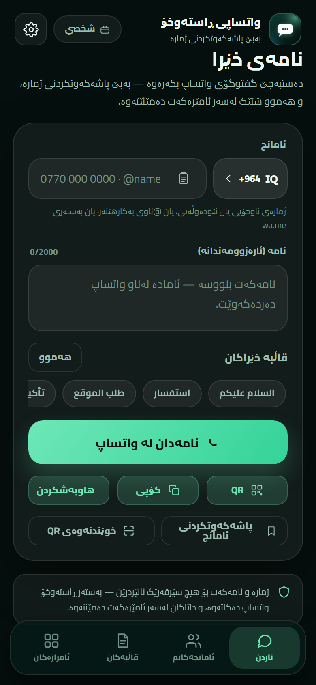 | 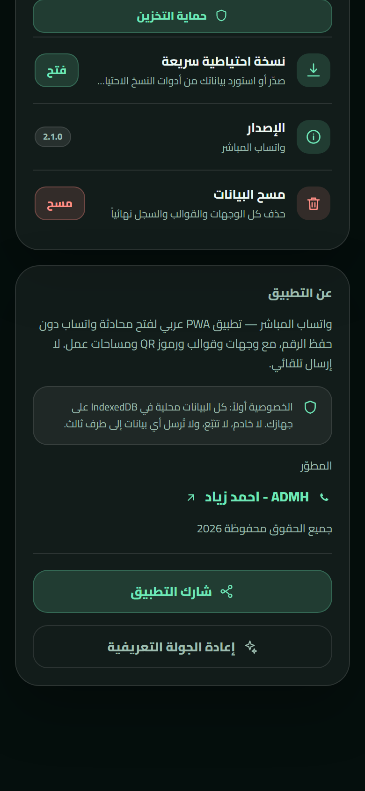 |

| الإرسال بالفارسية | الخط — فارسي |
|---|---|
| 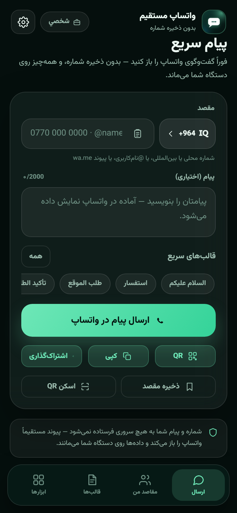 | 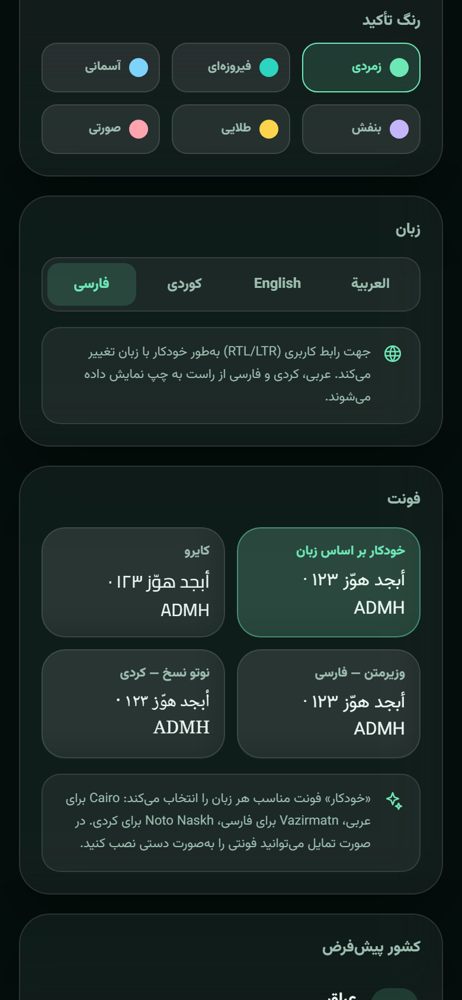 |

| نقل البيانات | فحص البيانات |
|---|---|
| 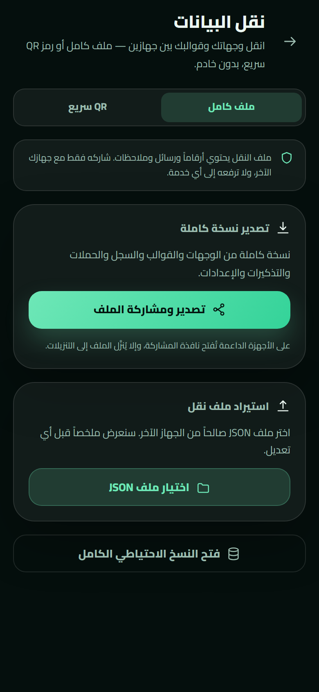 | 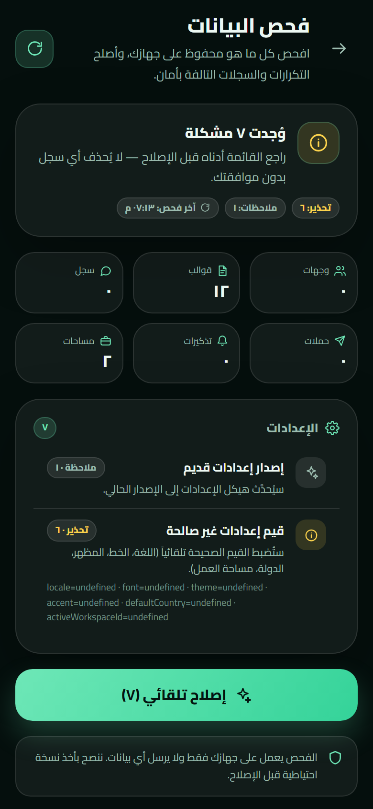 |

> لقطات مولّدة من نسخة التطوير ببيانات تجريبية (`?demo=1`).

---

## التقنية

| الطبقة | الاختيار |
|---|---|
| الواجهة | React 19 + TypeScript + Vite 6 |
| التنسيق | Tailwind CSS 4 + نظام تصميم Aurora Glass |
| الخطوط | Cairo (عربي/إنجليزي)، Vazirmatn (فارسي)، Noto Naskh Arabic (كردي) — مضمّنة محلياً |
| التخزين | IndexedDB عبر Dexie |
| QR | `qrcode` للتوليد + `jsqr` للقراءة (مع `BarcodeDetector` عند توفره) |
| PWA | `vite-plugin-pwa` (injectManifest) + Workbox: precache، Share Target، إشعارات |
| Android | Capacitor 8 + إضافات LocalNotifications/Camera/Clipboard/FileTransfer/FileOpener/Biometric/Share/Filesystem |
| اللغات | i18n مخصص (ar/en/ckb/fa) + قاموسان كردي وفارسي يُحمَّلان عند الطلب |
| الاختبارات | Vitest |

---

## التشغيل محلياً

```bash
pnpm install
pnpm dev        # http://127.0.0.1:5173
pnpm test       # اختبارات الوحدة
pnpm typecheck  # فحص الأنواع
pnpm build      # إنتاج dist/
pnpm preview    # معاينة الإنتاج
```

> يتطلب Node 22+ وpnpm 9+.
> في وضع التطوير يمكن تحميل بيانات تجريبية بفتح `http://127.0.0.1:5173/?demo=1` (لا تُضمَّن في نسخة الإنتاج).

---

## البنية

```
src/
├─ App.tsx                # الهيكل، التنقّل، القفل، التحديث/التثبيت
├─ main.tsx
├─ components/            # مكوّنات مشتركة (ui, icons, nav, banners)
├─ features/
│  ├─ compose/            # شاشة الإرسال
│  ├─ targets/            # الوجهات والسجل
│  ├─ templates/          # القوالب
│  ├─ tools/              # QR، البطاقات، الملصقات، النسخ الاحتياطي، التشخيص…
│  └─ settings/           # الإعدادات والقفل
├─ lib/                   # phone, whatsapp, db, qr, scan, backup, i18n, update…
├─ hooks/                 # استعلامات Dexie الحيّة
└─ styles/                # نظام التصميم
tests/                    # Vitest
docs/                     # المواصفات والمعاينة
android/                  # مشروع Capacitor Android
```

---

## النشر على GitHub Pages

1. ارفع المشروع إلى GitHub.
2. من **Settings → Pages** اختر **Source: GitHub Actions**.
3. كل دفع إلى `main` يشغّل `.github/workflows/deploy.yml` (فحص أنواع + اختبارات + بناء + نشر).

المشروع يستخدم `base: './'` ومسارات hash، لذلك يعمل تحت مسار المستودع دون إعداد إضافي.

---

## بناء تطبيق Android (APK)

- محلياً (يتطلب JDK 21 + Android SDK): `pnpm android:sync` ثم افتح `android/` في Android Studio، أو نفّذ `cd android && ./gradlew assembleRelease` مع متغيرات keystore.
- آلياً: كل دفع إلى `main` يشغّل `.github/workflows/android.yml` ويبني `app-release.apk` موقّعاً ويرفعه كـArtifact — **بدون متجر أو حساب**.
- الـAPK الحالي **Release موقّع بمفتاح ثابت** (محفوظ خارج المستودع)؛ لذلك تُثبَّت التحديثات فوق النسخة الحالية دون حذف البيانات.
- بيانات Android منفصلة عن PWA؛ استخدم شاشة **نقل البيانات** أو النسخ الاحتياطي.

---

## الخصوصية

- لا خادم، لا حساب، لا تحليلات، ولا تُرسل بياناتك. نسخة Android تفحص GitHub Releases للتحقق من التحديث وتنزيله عند موافقتك فقط.
- الأرقام والرسائل والقوالب والصور المولّدة تبقى على جهازك.
- الكاميرا لا تعمل إلا بعد طلب صريح وتُوقف عند مغادرة الشاشة.
- لا يُرسل أي رقم أو صورة إلى خدمة QR خارجية.

---

## الاختبارات

- اختبارات وحدة لتطبيع الأرقام وتحليلها، بناء رابط واتساب، متغيّرات القوالب، CSV وvCard، ومقارنة إصدارات التحديث.
- مصفوفة اختبار يدوية: Android Chrome، iOS Safari، Samsung Internet، سطح المكتب.
- تحقق من Lighthouse (Performance/Accessibility ≥ 95 وPWA installable) بعد النشر.

---

## سجل الإصدارات

| الإصدار | أبرز ما أضافه |
|---|---|
| **2.4.0-beta.3** | تنظيف تلقائي للسجل، وسلة محذوفات واستعادة حتى 30 يوماً |
| **2.4.0-beta.2** | معاينة واتساب/بطاقة/ملصق، زر التذكيرات، وفحص تحديث يدوي |
| **2.4.0-beta.1** | مرفقات جلسة، معاينة واتساب، وQuick Schedule |
| **2.4.0-alpha.1** | تذكيرات متكررة وإشعارات محلية، ونسخة احتياطية قبل الترقية |
| **2.3.5** | زر «فحص التحديثات» يدوي في الإعدادات على الويب وAndroid |
| **2.3.4** | زر «شارك التطبيق»: خيار مشاركة PWA وخيار رابط تنزيل APK |
| **2.3.3** | لصق/حافظة أصلية، حالة تخزين دائم صحيحة، إرسال التقرير للمطوّر عبر واتساب، وتنزيل APK بشريط تقدم وزر تثبيت |
| **2.3.2** | قفل بصمة أصلية Android مع PIN احتياطي، وفاحص تحديث APK داخل التطبيق |
| **2.3.1** | إصلاحات Android: تشخيص التطبيق الأصلي، المشاركة الأصلية، وتوقيع APK ثابت |
| **2.3.0** | نقل البيانات عبر ملف/QR، فحص وإصلاح البيانات، التشخيص ومصفوفة اختبار الأجهزة، تطبيق Android APK (Capacitor) |
| **2.2.0** | اللغة الفارسية، خط لكل لغة (Cairo/Vazirmatn/Noto Naskh)، README متعدد اللغات |
| **2.1.0** | رابط المطوّر، إكمال تلقائي، جولة تعريفية و«ما الجديد»، QR من صورة مشتركة، إشعارات التذكيرات، البصمة أولاً، شاشات PWA، حماية التخزين، الكردية السورانية |
| **2.0.0** | إعادة بناء كاملة: React + PWA، Aurora Glass، Cairo، بلا خادم، Share Target، أوفلاين، نسخ احتياطي، مساحات عمل |
| **1.0.0** | النسخة الثابتة الأولى (HTML/JS) |

---

## وثائق

- [المواصفات وخطة البناء](SPEC.md)
- [عقد التطوير](docs/DEV-CONTRACT.md)
- [مصفوفة اختبار الأجهزة](docs/DEVICE-TEST-MATRIX.md)
- [معاينة الاتجاه البصري](docs/mockups/design-directions.png)

---

## الطرف الثالث

الخطوط Cairo وVazirmatn وNoto Naskh Arabic (OFL) — `qrcode` (MIT) — `jsQR` (Apache-2.0) — React/Vite/Dexie/Tailwind (MIT) — Capacitor وإضافاته (MIT) — `@capgo/capacitor-native-biometric` (MPL-2.0). التفاصيل في [THIRD-PARTY-NOTICES.md](THIRD-PARTY-NOTICES.md).

---

## المطوّر

<div align="center">

**ADMH - Ahmed Zeyad**

[GitHub](https://github.com/ahmdze) · [WhatsApp](https://wa.me/9647723064622)

<sub>
جميع الحقوق محفوظة 2026<br />
تم التطوير باستخدام<br />
<strong>Deepseek-V4.1-Flash 1017 in Deepseek HARNESS</strong><br />
<strong>Deepseek-V4.1-Pro in Deepseek HARNESS</strong><br />
المراجعة التقنية والفنية بواسطة<br />
<strong>Qwen 3.8-Max</strong>
</sub>

</div>
