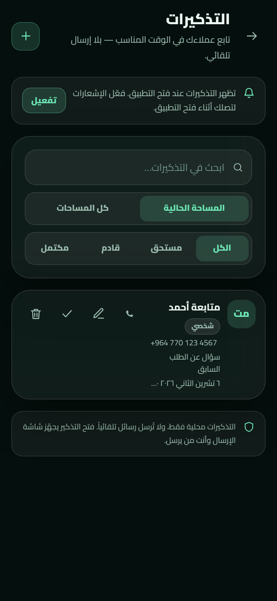

<div align="center">


# واتساب المباشر
### محادثة واتساب، من دون حفظ الرقم

رقم أو اسم مستخدم أو رابط — افتح المحادثة خلال ثوانٍ، واحتفظ بوجهاتك ورسائلك وأدواتك على جهازك.

[**استخدم نسخة الويب**](https://ahmdze.github.io/ADMH-DirectWhatsApp/)　·　[**نزّل تطبيق Android**](https://github.com/ahmdze/ADMH-DirectWhatsApp/releases/latest)　·　[استكشف المشروع](#للمطورين)

<br />

<a href="https://github.com/ahmdze/ADMH-DirectWhatsApp/releases/tag/v2.4.3"></a>
&nbsp; 
&nbsp; 

<p>اللغة: <strong>العربية</strong> · <a href="https://ahmdze.github.io/ADMH-DirectWhatsApp/guide/?lang=en">English</a> · <a href="https://ahmdze.github.io/ADMH-DirectWhatsApp/guide/?lang=ckb">کوردی</a> · <a href="https://ahmdze.github.io/ADMH-DirectWhatsApp/guide/?lang=fa">فارسی</a></p>

</div>

---

> **خصوصيتك أولاً:** لا حساب ولا خادم للتطبيق. بياناتك محفوظة محلياً، ولا يرسل التطبيق الرسائل تلقائياً؛ أنت تراجع المحادثة وترسلها بنفسك.

## لمحة سريعة

**💬 افتح محادثة**　رقم محلي أو دولي، `@اسم مستخدم`، أو رابط واتساب.  
**📇 رتّب جهاتك**　جهات وقوالب وسجل محادثات في مساحات عمل منفصلة.  
**🔳 أنشئ وشارك**　رموز QR، بطاقات تواصل، ملصقات، ومرفقات جلسة.

## شاهد التطبيق

<p align="center">
<a href="docs/screenshots/compose-dark.png"></a>
<a href="docs/screenshots/targets-dark.png"></a>
<a href="docs/screenshots/qr-dark.png"></a>
</p>

<p align="center"><sub>الإرسال　·　الوجهات　·　أدوات QR</sub></p>

<details>
<summary>شاهد لقطات إضافية — الوضع الفاتح، اللغات، التذكيرات، ونقل البيانات</summary>

<p align="center">
<a href="docs/screenshots/compose-light.png"></a>
<a href="docs/screenshots/settings-dark.png"></a>
<a href="docs/screenshots/reminders-v24-ar.png"></a>
</p>
<p align="center"><sub>الوضع الفاتح　·　الإعدادات　·　التذكيرات</sub></p>

<p align="center">
<a href="docs/screenshots/compose-kurdish.png"></a>
<a href="docs/screenshots/compose-persian.png"></a>
<a href="docs/screenshots/transfer-v23.png"></a>
</p>
<p align="center"><sub>الكردية　·　الفارسية　·　نقل البيانات</sub></p>

> لقطات مولّدة من نسخة التطوير ببيانات تجريبية (`?demo=1`).

</details>

## مصمم للاستخدام اليومي

### اكتب وافتح

- تنسيق الأرقام تلقائياً مع اختيار الدولة واكتشافها.
- اكتب رسالة اختيارية، استخدم قالباً، ثم راجع المعاينة قبل فتح واتساب.
- افتح المحادثة أو انسخ رابطها أو شاركها من جهازك.

### احفظ ونظّم

- احتفظ بالوجهات مع الاسم والوسوم والملاحظات والمفضلة.
- أنشئ قوالب برسائل قابلة للتخصيص ومتغيرات مثل `{الاسم}` و`{التاريخ}`.
- افصل بيانات العمل عن الاستخدام الشخصي عبر مساحات العمل.

### أدوات عملية

- أنشئ رموز QR واقرأها بالكاميرا أو من صورة.
- صمّم بطاقة مشاركة أو vCard وملصقات QR للطباعة على A4.
- أنشئ تذكيرات متابعة، وانقل بياناتك أو صدّر نسخة احتياطية.

### يعمل على لغتك وجهازك

العربية، English، کوردی (سوراني)، فارسی — مع اتجاه وخط مناسبين لكل لغة. استخدمه كتطبيق ويب تقدمي (PWA)، أو ثبّت APK على Android.

## الويب أم Android؟

### 🌐 نسخة الويب (PWA)

- [افتح التطبيق](https://ahmdze.github.io/ADMH-DirectWhatsApp/) وثبّته من قائمة المتصفح إن رغبت.
- بعد التحميل الأول، الواجهة والبيانات المحلية متاحة دون اتصال.
- التذكيرات تظهر عند فتح التطبيق، وفق دعم المتصفح.
- البيانات محفوظة في IndexedDB ضمن ملف المتصفح.
- يطلب التطبيق موافقتك قبل تطبيق تحديث PWA.

### 🤖 تطبيق Android (APK)

- [نزّل أحدث إصدار](https://github.com/ahmdze/ADMH-DirectWhatsApp/releases/latest) وثبّته مباشرة.
- واجهة التطبيق وبياناته محليتان؛ يلزم الاتصال بالإنترنت لإكمال المحادثة في واتساب.
- يدعم الإشعارات المحلية المجدولة، حتى عند إغلاق التطبيق.
- بياناته منفصلة عن PWA؛ استخدم النسخ الاحتياطي أو أداة النقل لنقلها.
- افحص التحديث يدوياً؛ لا يبدأ التنزيل أو التثبيت إلا بموافقتك.

## الخصوصية والبيانات

- لا حساب ولا خادم للتطبيق ولا أدوات تحليل مضمّنة؛ بياناتك تبقى على جهازك.
- لا تُرسل الرسائل تلقائياً. التطبيق يفتح وجهة واتساب لتكمل الإرسال بنفسك.
- الكاميرا لا تعمل إلا بإذن صريح، وتتوقف عند مغادرة شاشة المسح.
- عند فحص تحديث Android، يتصل التطبيق بـGitHub Releases. لا ينزّل APK إلا بعد موافقتك.
- لا تُرسل الصور أو الأرقام إلى خدمة QR خارجية.
- تخزين PWA وتخزين Android منفصلان. استخدم النسخ الاحتياطي أو نقل البيانات للانتقال بينهما.

<details>
<summary>كل الميزات بالتفصيل</summary>

### الأساس والإرسال

> تظهر شارة الإصدار في بداية كل ميزة لتسهيل المسح البصري ومعرفة وقت إضافتها.

- &nbsp;إدخال رقم محلي/دولي أو `@اسم مستخدم` أو رابط واتساب، مع تنسيق تلقائي وكشف الدولة.
- &nbsp;إكمال تلقائي للوجهات المحفوظة أثناء الكتابة.
- &nbsp;منتقي دولة عربي (60+ دولة) مع بحث، ودولة افتراضية قابلة للحفظ.
- &nbsp;رسالة اختيارية مع عدّاد أحرف (2000 حرف)، وقوالب سريعة.
- &nbsp;فتح المحادثة، نسخ الرابط، والمشاركة عبر Web Share API.
- &nbsp;سجل ذكي لآخر المحادثات، ووجهات محفوظة بأسماء ووسوم وملاحظات ومفضلة.
- &nbsp;قوالب رسائل قابلة للإنشاء والتعديل، مع متغيّرات `{الاسم}` `{الجهة}` `{التاريخ}`.
- &nbsp;توليد QR (PNG/SVG) وقراءة QR بالكاميرا أو من صورة (مع بديل jsQR).
- &nbsp;بطاقة مشاركة PNG عالية الدقة، وبطاقة تواصل vCard.
- &nbsp;مظهر داكن/فاتح/تلقائي + اختيار لون التمييز.
- &nbsp;جولة تعريفية عند أول تشغيل وشاشة «ما الجديد» بعد كل تحديث.
- &nbsp;أربع لغات: العربية (افتراضية)، English، کوردی، فارسی — مع تحميل قاموس الكردية/الفارسية عند الطلب فقط.
- &nbsp;خط تلقائي مناسب لكل لغة: Cairo للعربية، Vazirmatn للفارسية، Noto Naskh للكردية، مع إمكانية تثبيت خط يدوياً.
- &nbsp;لصق ذكي من الحافظة الأصلية في Android، واستخراج رقم من نص ملصوق.
- &nbsp;زر «شارك التطبيق» بخيارين: مشاركة تطبيق PWA أو رابط تنزيل APK.
- &nbsp;**مرفقات جلسة محلية**: صور وملفات وvCard تُشارك عبر نافذة النظام ولا تُخزَّن في التطبيق، مع ضغط صور WebP وبديل تنزيل.
- &nbsp;**معاينة قبل الإرسال** بنمط واتساب، وبطاقة مشاركة، وملصق QR — كلها محلياً ودون جلب روابط.
- &nbsp;**جدولة سريعة** لتذكير من Compose بالوجهة والرسالة الحالية.

### تجربة الهاتف (PWA)

- &nbsp;شريط تنقّل سفلي، أوراق سفلية، حركات خفيفة، اهتزاز، وحالات فارغة/تحميل/أخطاء مصممة.
- &nbsp;تثبيت PWA، عمل كامل دون اتصال، وتحديث بموافقة المستخدم.
- &nbsp;Share Target لاستقبال نص/رابط من تطبيق آخر.
- &nbsp;استقبال **صورة QR مشتركة** من تطبيق آخر ومسحها تلقائياً (Android).
- &nbsp;اختصارات أيقونة التطبيق: «إرسال سريع» و«مسح QR».
- &nbsp;قفل اختياري بـPIN أو بصمة (WebAuthn).
- &nbsp;البصمة كطريقة فتح أساسية مع بقاء PIN كبديل.
- &nbsp;إشعارات محلية لتذكيرات المتابعة عند فتح التطبيق.
- &nbsp;لافتة تثبيت أذكى (تظهر على الهاتف فقط، بعد تأخير، وتُخفى بعد التثبيت).
- &nbsp;شاشات معاينة في manifest و`handle_links`/`launch_handler` لفتح الروابط داخل التطبيق المثبّت.
- &nbsp;شاشة خطأ أنيقة مع خيار إصلاح نسخة التطبيق.
- &nbsp;طلب تخزين دائم وتنبيه عند اقتراب نفاد المساحة.
- &nbsp;نسخ احتياطي/استعادة JSON، وتصدير CSV.
- &nbsp;نقل البيانات بين جهازين عبر ملف أو QR، وفحص وإصلاح البيانات، وتشخيص الجهاز.
- &nbsp;زر **«فحص التحديثات»** يدوي فقط في الإعدادات: لا يوجد فحص تلقائي في الخلفية، حفاظاً على الخصوصية وتقليل الطلبات.
- &nbsp;**زر التذكيرات** في شريط التنقل السفلي للوصول بضغطة واحدة.

### الأدوات والبيانات

- &nbsp;ملصقات QR للطباعة على A4 (شبكة 2×4 أو 3×8) — مناسبة للمتاجر والمطاعم.
- &nbsp;إحصاءات محلية (آخر 7 أيام، الأكثر استخداماً).
- &nbsp;مساحات عمل (شخصي/عمل) مع فصل كامل للبيانات.
- &nbsp;حملات قائمة أرقام: فتح المحادثات بالتتابع مع متابعة يدوية «أُرسلت/تخطيت» — **لا إرسال تلقائي**.
- &nbsp;تذكيرات متابعة تظهر عند فتح التطبيق.
- &nbsp;**تذكيرات متكررة** (يومي/أسبوعي/شهري) مع إشعارات محلية وجدولة في Android، وفتح Compose من الإشعار.
- &nbsp;**نسخة احتياطية تلقائية قبل الترقية**، قابلة للتنزيل من الإعدادات.
- &nbsp;استيراد جهات من CSV/vCard أو Contact Picker.
- &nbsp;**نقل البيانات** بين جهازين عبر ملف أو رمز QR، بدون خادم.
- &nbsp;**فحص وإصلاح البيانات** المحلية (تكرارات، أرقام تالفة، سجلات يتيمة) مع معاينة قبل الإصلاح.
- &nbsp;**تنظيف تلقائي للسجل وسلة محذوفات**: حذف تلقائي لسجل المحادثات القديم، وسلة محذوفات تتيح استعادة العناصر حتى 30 يوماً.
- &nbsp;**تشخيص الجهاز** (قدرات المتصفح/الكاميرا/الإشعارات/التخزين) وتصدير تقرير، مع [مصفوفة اختبار الأجهزة](docs/DEVICE-TEST-MATRIX.md).
- &nbsp;**إرسال إلى المطوّر** من التشخيص: يفتح واتساب مع التقرير الكامل.
- &nbsp;**تطبيق Android أصلي (APK)** يعمل بجانب PWA، مع إشعارات مجدولة في الخلفية، وشارة/أيقونة أصلية.
- &nbsp;**قفل بالبصمة الأصلية** في Android، مع بقاء PIN بديلاً دائماً.
- &nbsp;**فاحص تحديث APK** داخل التطبيق، مع تنزيل داخلي بشريط تقدم ثم زر تثبيت.
- &nbsp;**Share Target أصلي في APK** لاستقبال نص أو روابط أو صور من نافذة مشاركة Android مباشرة.
- &nbsp;**اختصارات أيقونة التطبيق**: «إرسال سريع» و«مسح QR» و«التذكيرات».
- &nbsp;**اسم التطبيق على شاشة Android** يتغيّر حسب اللغة المختارة داخل التطبيق (الأيقونة موحّدة).

---

</details>

## للمطورين

### المتطلبات والتشغيل

يتطلب Node.js 22+ وpnpm 9+.

```bash
pnpm install
pnpm dev        # http://127.0.0.1:5173
pnpm test       # اختبارات الوحدة
pnpm typecheck  # فحص الأنواع
pnpm build      # إنتاج dist/
pnpm preview    # معاينة الإنتاج
```

لتحميل بيانات تجريبية في وضع التطوير، افتح `http://127.0.0.1:5173/?demo=1`.

### التقنية

| المجال | الأدوات |
|---|---|
| الواجهة | React 19، TypeScript، Vite 6 |
| التصميم | Tailwind CSS 4، نظام Aurora Glass |
| البيانات | IndexedDB عبر Dexie |
| PWA | vite-plugin-pwa، Workbox، Service Worker مخصص |
| Android | Capacitor 8 وإضافاته الأصلية |
| QR | `qrcode` للتوليد، `jsqr` و`BarcodeDetector` للقراءة |
| الاختبارات | Vitest |

### تنظيم المشروع

```text
src/
├─ App.tsx                # الهيكل والتنقل والقفل والتحديث
├─ components/            # مكونات الواجهة المشتركة
├─ features/              # compose, targets, templates, tools, settings
├─ lib/                   # التخزين، QR، الأرقام، النسخ الاحتياطي، التحديثات
├─ hooks/                 # استعلامات Dexie
└─ styles/                # نظام التصميم
android/                  # مشروع Capacitor Android
tests/                    # اختبارات Vitest
docs/                     # الوثائق واللقطات
```

### النشر وبناء APK

- النشر إلى GitHub Pages يتم عبر `.github/workflows/deploy.yml` عند الدفع إلى `main` بعد فحص الأنواع والاختبارات والبناء.
- بناء APK يتم عبر `.github/workflows/android.yml` عند الدفع إلى `main`. يحتاج توقيع الإصدار إلى أسرار Android keystore في إعدادات المستودع.
- يرفع سير العمل APK موقّعاً كـArtifact لمدة **14 يوماً**. تنزيل Artifact يختلف عن تنزيل إصدار منشور في صفحة Releases.
- للبناء المحلي الموقّع، استخدم JDK 21 وAndroid SDK واضبط `ANDROID_KEYSTORE_PATH` و`ANDROID_KEYSTORE_PASSWORD` و`ANDROID_KEY_ALIAS` و`ANDROID_KEY_PASSWORD` قبل `./gradlew assembleRelease`.
- مفتاح التوقيع الثابت ضروري لتثبيت تحديث APK فوق النسخة الحالية مع الحفاظ على بياناتها.

### الاختبارات

تغطي اختبارات الوحدة تحليل الأرقام، وروابط واتساب، ومتغيرات القوالب، وCSV/vCard، والنسخ الاحتياطي، والترحيل، وجدولة التذكيرات والتحديثات. توجد أيضاً [مصفوفة الاختبار اليدوي](docs/DEVICE-TEST-MATRIX.md).

## سجل الإصدارات

| الإصدار | أبرز التغييرات |
|---|---|
| **2.4.3** | Share Target أصلي، اختصارات التطبيق، اسم التطبيق حسب اللغة، وصفحة دليل متعددة اللغات |
| **2.4.2** | فتح الموقع عبر Capacitor Geolocation ورسائل خطأ أدق |
| **2.4.1** | إعادة زر الأدوات إلى شريط التنقل وتحسين فحص التحديث |
| **2.4.0** | تذكيرات متكررة، مرفقات ومعاينة، تنظيف السجل وسلة محذوفات |
| **2.3.0** | نقل البيانات، فحصها، تشخيص الجهاز، وإطلاق APK |
| **2.2.0** | إضافة الفارسية وخطوط ملائمة وتوثيق متعدد اللغات |
| **2.1.0** | الكردية، الإكمال التلقائي، الجولة التعريفية وإشعارات التذكير |
| **2.0.0** | إعادة بناء React وPWA والتخزين المحلي ومساحات العمل |
| **1.0.0** | النسخة الثابتة الأولى |

للتغييرات التفصيلية راجع [CHANGELOG.md](CHANGELOG.md).

## الوثائق والتراخيص

- [المواصفات وخطة البناء](SPEC.md) · [عقد التطوير](docs/DEV-CONTRACT.md) · [مصفوفة الأجهزة](docs/DEVICE-TEST-MATRIX.md)
- الخطوط Cairo وVazirmatn وNoto Naskh Arabic مرخصة بـOFL. تفاصيل تراخيص الاعتماديات في [THIRD-PARTY-NOTICES.md](THIRD-PARTY-NOTICES.md).

## المطوّر

<div align="center">

**ADMH - Ahmed Zeyad**

[GitHub](https://github.com/ahmdze) · [WhatsApp](https://wa.me/9647723064622)

<sub>تم التطوير باستخدام Deepseek HARNESS · المراجعة التقنية والفنية بواسطة Qwen</sub>

<sub>
جميع الحقوق محفوظة 2026<br />
تم التطوير باستخدام<br />
<strong>Deepseek-V4.1-Flash 1017</strong><br />
<strong>Deepseek-V4.1-Pro</strong><br />
<br />
<strong>Qwen 3.8-Max</strong><br />
<br />
<a href="docs/screenshots/usage-dashboard.jpg"><strong>Usage and Cost</strong></a>
</sub>

</div>
